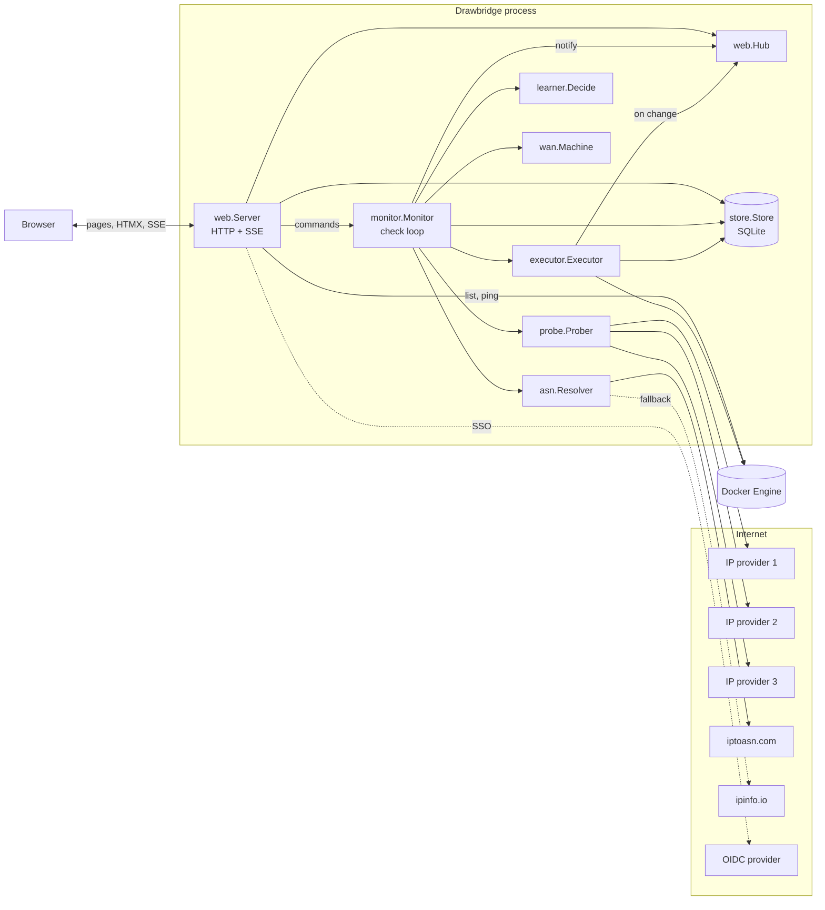
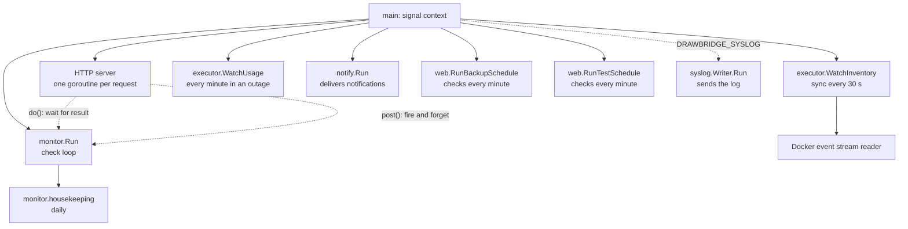
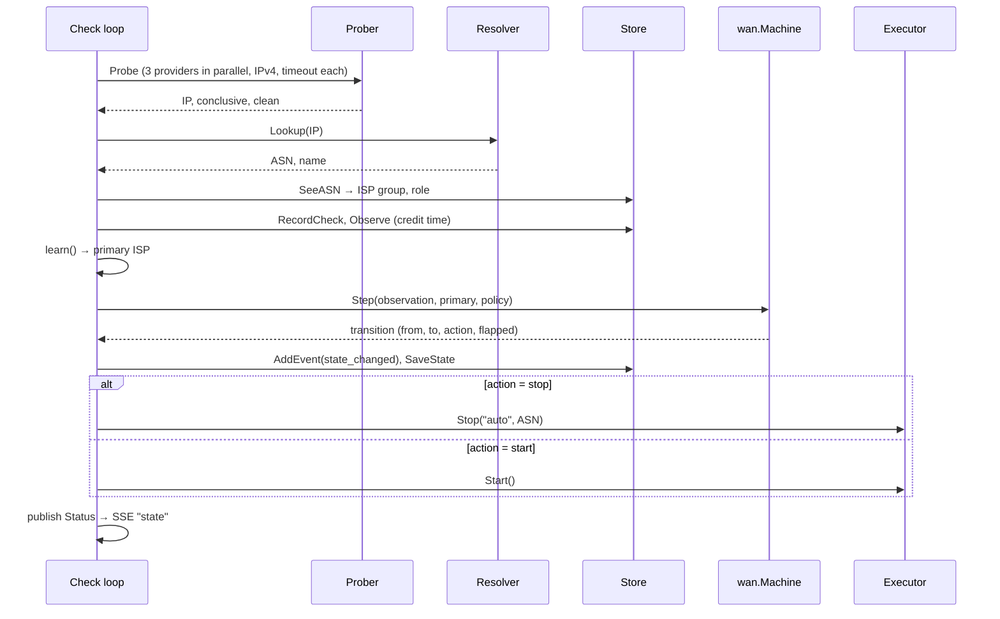

# Architecture

Drawbridge is a single Go binary (`cmd/drawbridge`) with no runtime
dependencies besides the Docker socket and a writable folder. It embeds its
database driver (pure-Go SQLite), its migrations, its HTML templates and its
static assets (HTMX, CSS, a small script).

## Components



| Package | Responsibility |
| --- | --- |
| `cmd/drawbridge` | Entry point: configuration, wiring, the HTTP server, graceful shutdown, CLI subcommands. |
| `internal/config` | Environment variables, defaults and validation of detection settings. |
| `internal/probe` | Finds the public IPv4 address by querying providers in parallel and applying the quorum. |
| `internal/asn` | Maps an IP to an ASN: offline iptoasn table (binary search), online fallback, per-IP cache. |
| `internal/learner` | Pure function deciding the primary ISP from observed time. |
| `internal/wan` | Pure failover state machine: observation in, transition and action out. |
| `internal/monitor` | The check loop. Owns the state machine, runs the learner, persists state, calls the executor. |
| `internal/executor` | Stops and starts containers for runs; keeps the container inventory in sync with Docker. |
| `internal/docker` | Minimal Docker Engine API client (list, inspect, stop, start, events, stats, version). |
| `internal/store` | All persistence: SQLite, migrations, users, sessions, ISPs, policies, runs, events. |
| `internal/secrets` | AES-GCM sealing of stored secrets. |
| `internal/totp` | Time-based one-time passwords (RFC 6238) for two-factor sign-in. |
| `internal/notify` | Notification channels: formats events into messages and delivers them in the background, with retries. |
| `internal/syslog` | Optional copy of the log to a syslog server: an `slog` handler that queues RFC 5424 or RFC 3164 messages, and a sender over UDP, TCP or TLS that reconnects. |
| `internal/backup` | Backup file format: argon2id key, AES-256-GCM, gzipped JSON of a `store.Snapshot`. |
| `internal/web` | HTTP handlers, templates, middleware (auth, CSRF, cross-origin, headers), OIDC, metrics, SSE hub. |
| `internal/e2e` | End-to-end test of the whole process against fakes. |

The two pure packages, `wan` and `learner`, contain the decisions that matter
most and have no I/O, so they are tested exhaustively with simulated time.

## Goroutines and ownership



**The check loop owns the WAN state.** `monitor.Run` is the only goroutine that
reads or writes the state machine, the current detection settings, the paused
flag and the prober. Everything else talks to it through a command channel
(capacity 16):

- `do(fn)` sends a function to run on the loop and waits for its result. Used
  for quick commands: pause, resume, check now, apply settings, relearn, the
  state change of manual failover/restore, and restoring a backup file
  (`LoadBackup`: refused while containers are stopped; the store is replaced
  between checks, then the settings are reloaded and a check is posted).
- `post(fn)` sends a function without waiting. Used for container runs started
  by commands, so that an HTTP request returns at once while containers stop.

The loop alternates between commands and timed checks:

```go
for {
    select {
    case <-ctx.Done():  return
    case cmd := <-cmds: cmd(ctx)
    case <-resume:      end a timed pause (only armed while one is set)
    case <-drill:       end a failover test (only armed while one runs)
    case <-next:        Check(); next = after(interval or 15 s while pending)
    }
}
```

Container runs triggered by checks execute **on the loop**, so no check runs
while containers are stopping or starting. This is deliberate: the state and
the run can never disagree. A run takes at most about 30 s per dependency
level to stop and, when starting, up to 2 minutes per level of health waits.

**Status is published, not shared.** After every change, the loop writes a
`monitor.Status` snapshot under a read-write mutex and calls `notify`, which
publishes the `state` topic on the SSE hub. HTTP handlers read the snapshot
with `Status()` and never touch loop-owned fields.

**The inventory watcher** runs `executor.Sync` every 30 seconds and about 2
seconds after Docker reports a container `create`, `destroy` or `rename`
event. It writes only the `stacks` and `containers` tables. It publishes the
`inventory` topic when the set of containers or their running state changes
(a fingerprint of ID, name and running flag), not on every sync.

**The usage watcher** (`executor.WatchUsage`) runs every minute. When an
outage is open (`outages.ended IS NULL`), it lists the containers and reads
each running one's network counters (`GET /containers/{id}/stats?stream=false&one-shot=true`),
writing only `outage_usage`.

**Notifications** are fed by the store: every recorded event is passed to
`Notifier.Event`, which queues it (64 at most, never blocking the caller) if
some channel could want it. `notify.Run` delivers the queue in order, to all
matching channels of an event in parallel.

**Scheduled failover tests** are started by `web.RunTestSchedule`, which
checks once at start and then every minute whether a scheduled time has
passed (at most an hour ago) without being handled, and then calls
`StartDrill` on the monitor like the dashboard button.

**Scheduled backups** are made by `web.RunBackupSchedule`, which checks
once at start and then every minute whether the day's backup time has passed
without a backup. It reads the store and writes files to
`DRAWBRIDGE_BACKUP_DIR`; it does not go through the check loop.

**Syslog**, when `DRAWBRIDGE_SYSLOG` is set, is a `syslog.Writer` started
before everything else: the logger writes each line to standard error and
queues a copy (1024 at most; dropped when full, never blocking), and
`Writer.Run` sends the queue on one connection, reconnecting after errors. It
is stopped last, after the database is closed, so the final log lines are
sent too.

**Housekeeping** runs once at start and then every 24 hours: prune old checks
and daily totals, prune expired sessions, refresh the ASN database if it is
older than a week.

**Concurrency in the database** is handled by SQLite in WAL mode with a 5
second busy timeout; writes are short transactions, each taking the write
lock when it begins, so writers queue rather than fail. The executor and the web
server both write, but never to the same rows at the same time in a way that
matters: policies are read by the executor at the start of each run.

## A check, end to end



The state is saved **before** the executor acts, so a crash in the middle of a
run is recovered on the next start (see
[Container control](container-control.md#crash-recovery)).

## Startup

`drawbridge` with no arguments:

1. Load and validate configuration from the environment; any error stops
   start-up with all problems listed. With `DRAWBRIDGE_SYSLOG`, start sending
   the log to syslog.
2. Create `DRAWBRIDGE_DB_DIR` and `DRAWBRIDGE_CACHE_DIR` (mode 0750).
3. Open `drawbridge.db` (WAL, busy timeout 5 s, foreign keys on,
   transactions that take the write lock when they begin) and run
   pending migrations.
4. Create the Docker client from `DOCKER_HOST` (default
   `unix:///var/run/docker.sock`) and ping it. Failure is logged, not fatal.
5. Parse trusted proxies; load or create the secret key.
6. Build the hub, executor, monitor, notifier and web server; start the
   notifier, the HTTP server, the inventory watcher, the backup schedule and
   the monitor.
7. The monitor loads its state and settings, refreshes the ASN database, and,
   unless paused, runs `recover()` to bring containers in line with the saved
   state. The first check runs immediately.

## Shutdown

On `SIGTERM` or `SIGINT` the root context is cancelled. The monitor finishes
the command or check in progress and returns; the HTTP server gets 5 seconds
to finish requests (`Shutdown`). The notifier, the inventory watcher and the
backup schedule are then stopped, and Drawbridge waits for them and the
monitor to return, so none of them is still writing when the database is
closed, which checkpoints the WAL into the main file. The same happens when
start-up fails after they were started (the listen address is in use, for
example). With syslog on, the sender stops after that, once it has sent what
is still queued (at most 2 seconds). A container run in progress is abandoned at the next
Docker call; its progress is in the database and is resumed by `recover()` on
the next start.

## External dependencies

| Library | Used for |
| --- | --- |
| `modernc.org/sqlite` | SQLite compiled to pure Go: no cgo, static binary |
| `github.com/pressly/goose/v3` | Embedded SQL migrations |
| `github.com/coreos/go-oidc/v3`, `golang.org/x/oauth2` | OIDC discovery, token verification, PKCE |
| `golang.org/x/crypto/argon2` | Password hashing |
| HTMX 2.0 + SSE extension (vendored JS) | Partial page updates and live updates without a JS build |

Everything else is the Go standard library, including the HTTP router
(`net/http` patterns) and cross-origin protection
(`http.CrossOriginProtection`).

## Design constraints

These were decided deliberately and should not be changed without
discussion:

- No Node.js or JavaScript build step; server-rendered HTML with HTMX.
- SQLite only. The database folder contains nothing but the database and the
  secret key, so it can be mounted and backed up on its own.
- Direct Docker socket access; no socket proxy.
- One instance per Docker host; not designed for load-balanced WANs.
- ISPs are groups of ASNs; every comparison is ISP to ISP.
