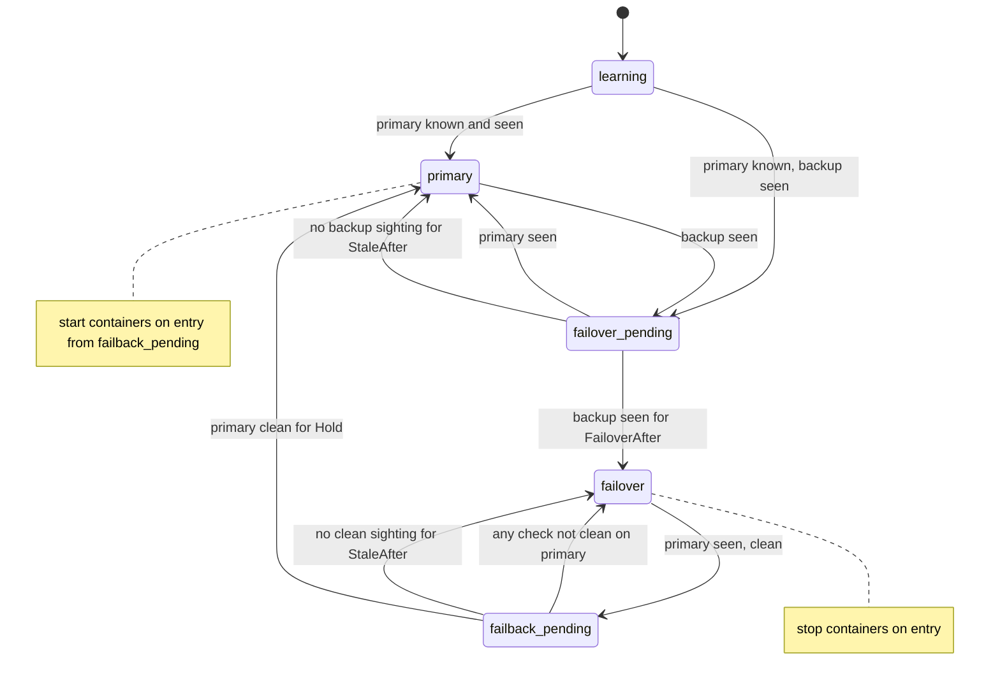

# WAN detection

How one check works, and the exact rules of the failover state machine. Code:
`internal/probe`, `internal/asn`, `internal/wan`, `internal/monitor`.

## 1. Probing the public IP

`probe.Prober.Probe` queries every configured provider **in parallel**.

Transport details, each chosen so that the answer reflects the current WAN:

- **IPv4 only.** The dialer always uses `tcp4`. Otherwise one provider could
  answer over IPv6 and disagree with the others for no real reason.
- **No connection reuse** (`DisableKeepAlives`). After a WAN switch, a kept-alive
  connection could still be routed over the old link.
- **Timeout** (`DRAWBRIDGE_TIMEOUT`, default 5 s) applies to dialing, the TLS
  handshake, and the whole request.
- `User-Agent: wan-drawbridge`; at most 4,096 bytes of the body are read.

### IP providers

Default providers:

| URL | Response format |
| --- | --- |
| `https://1.1.1.1/cdn-cgi/trace` | Cloudflare trace (`key=value` lines; the `ip=` line is used). Reached by IP, so it works without DNS. |
| `https://api.ipify.org` | Bare IP |
| `https://icanhazip.com` | Bare IP |

Any URL that returns either a bare IP or a body containing an `ip=` line works.
A provider's answer counts only if the status is 200 and the IP parses as IPv4
(IPv4-mapped IPv6 is unmapped). Each provider's URL, IP or error, and latency
is stored with the check.

### Quorum, conclusive and clean

- **Conclusive:** at least `quorum` providers (default 2) reported the same IP.
  That IP is the result.
- **Clean:** conclusive, and **no** provider reported a *different* IP.
  Providers that failed outright (timeout, error status) do not affect it.

The difference matters for failback (below). A provider that is down does not
block failback forever; a provider that sees another address does.

| Provider answers (quorum 2) | Conclusive | Clean |
| --- | --- | --- |
| A, A, A | yes (A) | yes |
| A, A, error | yes (A) | yes |
| A, A, B | yes (A) | **no** |
| A, B, error | no | no |
| error, error, error | no | no |

## 2. From IP to ISP

`asn.Resolver.Lookup`:

1. **Per-IP cache** (in memory; cleared when the database is reloaded).
2. **Offline table.** The iptoasn.com file `ip2asn-v4.tsv.gz` (columns: range
   start, range end, AS number, country, AS description) is parsed into a
   sorted slice of IPv4 ranges, skipping unrouted ranges (AS 0) and IPv6.
   Lookup is a binary search.
3. **Online fallback**, only if the address is not in the table:
   `GET https://ipinfo.io/<ip>/json`, reading `org` (`"AS64500 Examplenet Cable
   Communications, LLC"`) into ASN 64500 and name `Examplenet Cable
   Communications, LLC`.

If both fail, the check is logged as `asn lookup failed` and treated as
**inconclusive**.

The table is stored at `$DRAWBRIDGE_CACHE_DIR/ip2asn-v4.tsv.gz`. It is
downloaded (atomically: to `.tmp`, then renamed) when missing or older than 7
days, at start-up and once a day. A failed download keeps the copy on disk; if
there is none, Drawbridge runs on online lookups alone and logs `asn database
unavailable; using online lookups`.

The ASN then goes through `store.SeeASN`, which returns its ISP group and the
group's role (see [ISP grouping and learning](isp-grouping-and-learning.md)).
An ISP with role **ignored** turns the check into an inconclusive one.
For a conclusive check, `store.Metered` reads the ISP's `metered` flag.

## 3. The observation

Each check produces one `wan.Observation`:

| Field | Value |
| --- | --- |
| `At` | Time of the check |
| `Conclusive` | Probe conclusive, ASN resolved, ISP not ignored |
| `Clean` | Probe clean (and conclusive) |
| `ISP` | ISP group ID |

When a primary is known and the ISP is unmetered, the observation passed to
the state machine carries the primary's ID instead, so an unmetered backup
counts as the primary: no failover, and failback when in failover. The
status, events and `checks` keep the real ISP.

Two more facts are recorded per check: a row in `checks` (for the timeline and
history), and, for conclusive checks, observed time credited to the ASN (for
learning): `min(now − previous check, 2 × check interval)` seconds, or one
interval for the first check.

## 4. The state machine

`wan.Machine` is pure: `Step(observation, primaryISP, policy)` updates the
machine and returns a `Transition{From, To, Action, Flapped}`. The monitor
persists the machine and carries out the action.

### States

| State | Meaning | Check cadence |
| --- | --- | --- |
| `learning` | No primary ISP is known | interval |
| `primary` | On the primary ISP | interval |
| `failover_pending` | A backup was seen; confirming | `min(15 s, interval)` |
| `failover` | Confirmed on a backup; containers stopped | interval |
| `failback_pending` | The primary was seen clean; confirming it is stable | `min(15 s, interval)` |

### Policy

| Parameter | Source | Default |
| --- | --- | --- |
| `FailoverAfter` | Fail over after | 45 s |
| `FailbackAfter` | Fail back after | 5 min |
| `MaxHold` | Longest failback wait | 2 h |
| `FlapWindow` | fixed | 1 h |
| `FlapReset` | fixed | 6 h |
| `StaleAfter` | 3 × check interval | 3 min |

### Persisted fields

| Field | Meaning |
| --- | --- |
| `State` | Current state |
| `PendingSince` | When the pending change was first seen |
| `LastEvidence` | Last check that supported the pending change |
| `Flaps` | Consecutive flaps |
| `LastFailover`, `LastFailback` | Times of the last automatic failover and failback |

### Diagram

### Rules, precisely

For every observation, in order:

1. **Stale evidence.** If the state is pending, `LastEvidence` is set, and
   `obs.At − LastEvidence > StaleAfter`, the pending change is abandoned:
   `failover_pending → primary`, `failback_pending → failover`. Processing
   continues with the new state.
2. **No primary.** If `primaryISP == 0`: a conclusive observation sets the state
   to `learning`; an inconclusive one leaves it. No action. Stop.
3. Let *onPrimary* = conclusive ∧ ISP = primary; *onBackup* = conclusive ∧
   ISP ≠ primary.
4. By state:

| State | onPrimary | onBackup | Inconclusive |
| --- | --- | --- | --- |
| `learning`, `primary` | → `primary` | → `failover_pending` (`PendingSince = LastEvidence = now`), then try failover | stay |
| `failover_pending` | → `primary` | `LastEvidence = now`, try failover | stay (no evidence either way) |
| `failover` | if clean: → `failback_pending` (`PendingSince = LastEvidence = now`), then try failback | stay | stay |
| `failback_pending` | if clean: `LastEvidence = now`, try failback; if not clean: → `failover` | → `failover` | → `failover` |

**Try failover:** if `now − PendingSince ≥ FailoverAfter`:

1. If there was no failover before, or the last was at least `FlapReset` ago,
   set `Flaps = 0`.
2. If `LastFailback` is set and less than `FlapWindow` ago, this is a flap:
   `Flaps++`, `Flapped = true`.
3. State `failover`, `LastFailover = now`, action **stop**.

**Try failback:** if `now − PendingSince ≥ Hold`: state `primary`,
`LastFailback = now`, action **start**.

**Hold** (the current failback wait):
`min(FailbackAfter × 2^Flaps, max(MaxHold, FailbackAfter))`.

### Consequences worth knowing

- **Failover is lenient, failback is strict.** A dead primary often cannot be
  checked at all, so inconclusive checks do not interrupt a pending failover.
  Coming back, every check during the hold must be clean on the primary; one
  bad check sends the state back to `failover` and the hold starts again at
  the next clean sighting.
- **Total outage does nothing.** Inconclusive checks never move `primary` to
  `failover_pending`.
- **Unknown ISPs are backups.** Any conclusive ISP that is not the primary
  counts.
- **Zero delays act immediately.** With `FailoverAfter = 0`, the first backup
  sighting stops containers; with `FailbackAfter = 0`, the first clean primary
  sighting starts them.
- **Starting on a backup.** If a primary becomes known (learned or pinned)
  while traffic is on a backup, the next check enters `failover_pending` and
  fails over after the delay.
- **Flaps reset lazily.** The reset is evaluated at the next failover, so the
  dashboard keeps showing the longer hold until then.

### Worked timing

Defaults, interval 60 s. Primary fails at T.

| Time | Event |
| --- | --- |
| T + ≤60 s | First check on the backup → `failover_pending` (call it F) |
| F + 15, 30 s | Checks on the backup (or inconclusive) |
| F + 45 s | Check on the backup → `failover`, stop |

So containers stop between **45 s and 1 min 45 s** after the switch (plus check
duration). Primary returns at R:

| Time | Event |
| --- | --- |
| R + ≤60 s | First clean check on the primary → `failback_pending` (B) |
| B + 15 s … B + 4 min 45 s | Clean checks every 15 s |
| B + 5 min | → `primary`, start |

So containers start between **5 and 6 minutes** after the primary is back,
assuming it is stable.

## 5. Manual transitions

These bypass `Step` (in `monitor`):

| Command | State change | Action | Flap bookkeeping |
| --- | --- | --- | --- |
| Fail over now | → `failover` | stop (`trigger = manual`) | unchanged |
| Restore now | → `primary` | start | unchanged |
| Re-learn | primary cleared; learning period restarts | none until a primary is known | unchanged |

Manual transitions clear `PendingSince` and `LastEvidence` and log
`manual_failover` / `manual_restore` with `from`, `to`, `by`.

## 6. Paused automation

While paused (explicitly, or because setup is not finished), checks and the
state machine run normally and events are logged (failover and failback events
carry `"paused": true`), but no container action is taken. Resuming runs
`recover()`: in `failover`, stop; in `primary` or `learning`, start whatever an
open run holds; in pending states, nothing.

A timed pause (`PauseFor`) stores its end in the `paused_until` setting. The
loop waits on a timer for it alongside commands and checks, and at the end
resumes exactly as above, logging `resumed` with `by=timer`. An end time in
the past (Drawbridge was down) resumes at once after start. Before setup is
finished the end time is ignored, so a timed pause cannot turn automation on
early.

A failover test (`StartDrill`) is not a state: it stops the selected
containers with a run whose trigger is `drill`, and the loop starts them
again at its end time (`endDrill`). A confirmed failover, Fail over now or
Restore now ends it (`drill_ended`); a failover keeps the containers
stopped.

## 7. Settings changes

`ApplyDetection` validates, stores the settings and swaps the prober on the
loop goroutine; they take effect from the next check. The machine's persisted
fields are untouched, so a pending change keeps its `PendingSince` and is
judged against the new delays.
