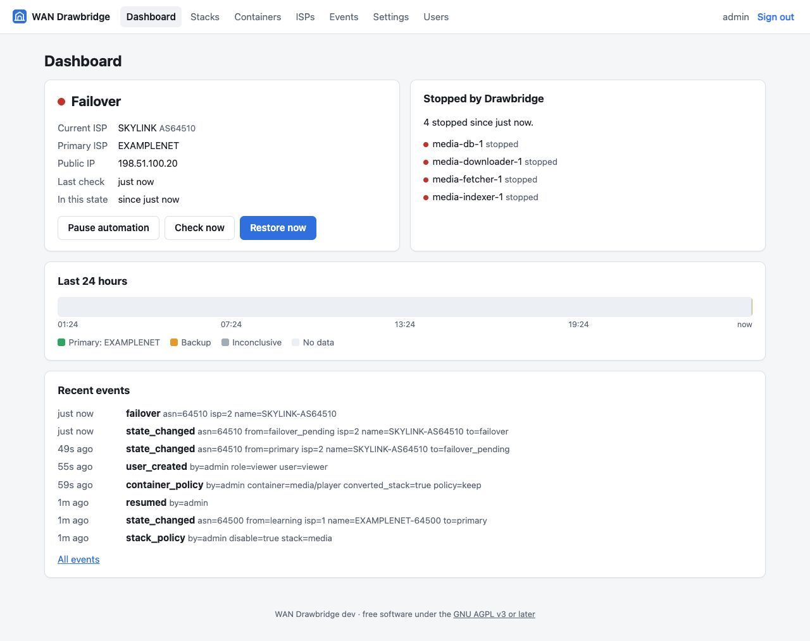
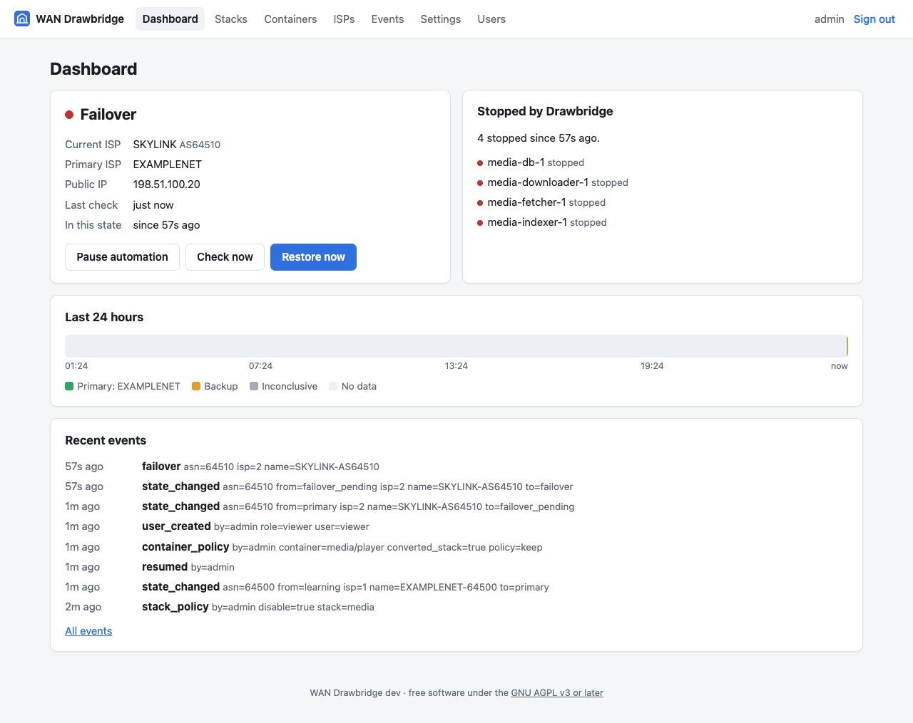
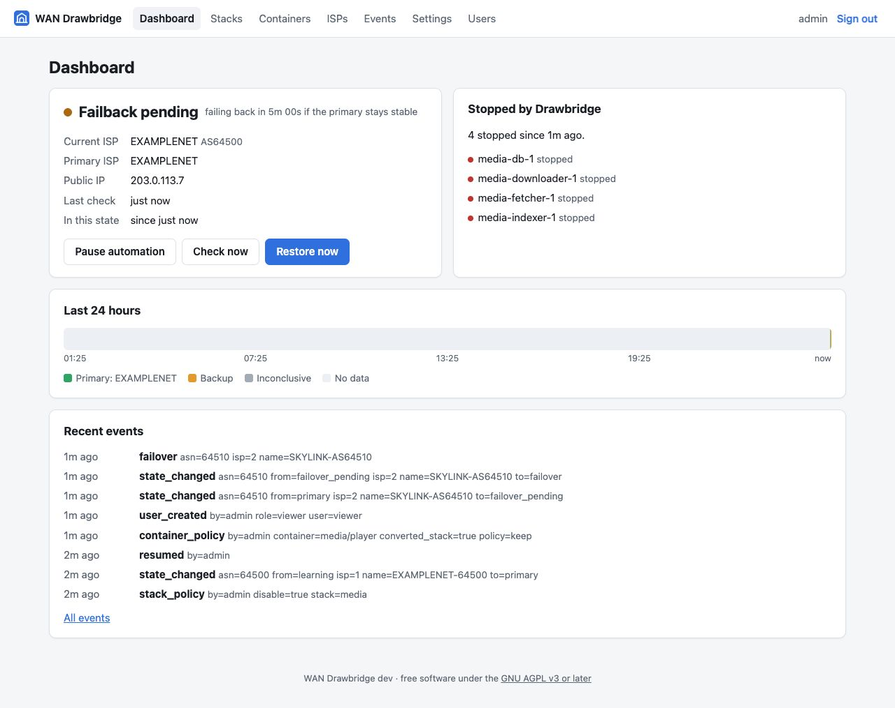

# What happens during an outage

This page follows a real failover from start to finish with the default
settings, then explains flapping, total outages and the manual controls.

Default timings used below:

| Setting | Default |
| --- | --- |
| Check interval | 1 minute |
| Check interval while confirming a change | 15 seconds |
| Fail over after | 45 seconds |
| Fail back after | 5 minutes |
| Longest failback wait | 2 hours |

## The short version

- Drawbridge stops your selected containers about **45 seconds to 1 minute 45
  seconds** after your traffic moves to a backup ISP (45 seconds of
  confirmation, plus up to one check interval before the first check notices).
- It starts them again about **5 to 6 minutes** after the primary is back and
  stable.
- A primary that keeps dropping makes Drawbridge wait longer before failing
  back each time, up to 2 hours, so your containers are not restarted every
  few minutes.
- If the internet is down completely, nothing happens.

## Step by step

### 12:00:00 — the primary goes down

Your router switches to the backup (an LTE modem, say). Drawbridge does not
know yet; its next check is due at most one minute later.

### 12:00:40 — the first check on the backup

The IP providers report an address that belongs to Skylink. That is not the
primary ISP, so the state becomes **Failover pending**.

The dashboard counts down: "failing over in 45s unless the primary returns".
Checks now run every 15 seconds.

During this time:

- A check that sees the **primary** again cancels the failover; the state goes
  back to **On primary**. A brief router hiccup never stops anything.
- A check that **reaches nothing** (all providers fail, which is common while a
  router is switching) neither cancels nor confirms. The countdown continues.
- If no check has supported the change for more than 3 check intervals
  (3 minutes), the pending failover is abandoned. That only happens when
  Drawbridge cannot check at all, for example while the host was asleep.

### 12:01:25 — failover

The backup has now been seen for 45 seconds. The state becomes **Failover**,
a `failover` event is logged, and Drawbridge stops the selected containers:
dependents first, then what they depend on, up to 4 at a time.

"Stopped by Drawbridge" lists each container. Containers that were already
stopped are recorded as "left alone" and will not be started later.

While in Failover, checks return to every minute.

### 13:30:00 — the primary comes back

The router returns to the primary. The next check (by 13:31:00 at the latest)
sees the primary with every IP provider agreeing. The state becomes
**Failback pending**, and checks run every 15 seconds again.

Failback is deliberately stricter than failover. For the next 5 minutes,
**every** check must be clean:

- on the primary ISP,
- conclusive (enough providers answered), and
- with no provider reporting a different IP.

Any check that fails these conditions, even one that reaches nothing, sends the
state back to **Failover** and the 5 minutes start again from the next clean
check. A connection that is "mostly back" does not count.

### 13:36:00 — failback

After 5 clean minutes, the state becomes **On primary**, a `failback` event is
logged, and Drawbridge starts the containers it stopped: dependencies first,
waiting for healthchecks (up to 2 minutes) before starting their dependents.
When all are started, the run is closed and "Stopped by Drawbridge" says
"Nothing. Every container is as you left it."

## Flapping

A primary connection that drops, comes back, and drops again (a "flapping"
connection) would otherwise make Drawbridge stop and start your containers over
and over. Drawbridge counts it as a **flap** when a failover happens less than
**one hour after a failback**. Each flap doubles the failback wait:

| Flaps in a row | Failback wait (default settings) |
| --- | --- |
| 0 | 5 minutes |
| 1 | 10 minutes |
| 2 | 20 minutes |
| 3 | 40 minutes |
| 4 | 80 minutes |
| 5 or more | 2 hours (the longest failback wait) |

With a primary that is up for 6 minutes and down for 2, over and over, this
means Drawbridge fails over, fails back after the first 6 minutes up, fails
over again (a flap: the wait becomes 10 minutes), and then stays failed over,
because the primary never stays up for 10 minutes. Two container restarts
instead of one every 8 minutes.

The count resets when a failover happens **six hours or more** after the
previous failover. Each flap logs a `flapping` event and a warning, and the
dashboard shows a banner with the current wait:

> The primary ISP has been flapping, so failback now waits 20m of stable
> connection (normally less). This resets after six hours without a failover.

The failover side is not slowed down by flapping: when the backup is confirmed,
containers stop after the usual 45 seconds.

## Total outage

If neither ISP works (power cut at the street, router down), every check is
inconclusive. Inconclusive checks never trigger a failover, so **nothing
happens**: containers keep running, and there is nothing to restart when the
connection returns. On the timeline the period shows as grey.

## When Drawbridge itself restarts

The state, the timers and the list of stopped containers are saved in the
database before Drawbridge acts. After a restart (an upgrade, a host reboot, a
crash in the middle of stopping containers):

- In **Failover**, Drawbridge makes sure every selected container is stopped,
  finishing an interrupted run. Containers already recorded keep their
  original "was running" status, so nothing is started later that you had
  stopped yourself.
- **On primary** (or Learning), it starts anything an unfinished run still
  holds.
- In a **pending** state, it simply continues the countdown with the next
  checks. If the restart took longer than 3 check intervals, the pending
  change is abandoned and re-detected.

## Paused automation

**Pause automation** on the dashboard keeps Drawbridge checking, logging and
changing state, but it does not touch any container. Events show
`"paused": true` for failovers and failbacks that happened while paused.

**Resume automation** brings containers in line with the current state right
away: in Failover the selected containers are stopped; on the primary,
containers Drawbridge stopped earlier are started.

Pause before maintenance on your network (swapping a router, testing the
backup link) so that Drawbridge does not react to it.

## Manual controls

**Fail over now** (shown when nothing is stopped) stops every selected
container immediately and puts the state in **Failover**, with a
`manual_failover` event. It does not wait for or require a backup ISP.
Afterwards Drawbridge behaves as after any failover: once it sees the primary
stable for the failback wait, it starts the containers again. If you want them
to stay stopped while you are on the primary, also **pause automation**.

**Restore now** (shown while Drawbridge holds stopped containers) starts them
and puts the state in **On primary**, with a `manual_restore` event. If traffic
is in fact still on a backup ISP, the normal checks see it and fail over again
after 45 seconds.

**Check now** runs a check immediately; it is useful right after you have
fixed something.

Both "Fail over now" and "Restore now" ask for confirmation, and only admins
see them.

## Tuning

| You want… | Change |
| --- | --- |
| Faster reaction to a failover | Lower **Fail over after** (even to `0s`) and the **Check interval**. |
| Fewer false failovers from brief switches | Raise **Fail over after**. |
| Containers back sooner | Lower **Fail back after**. Keep it above how long your router takes to settle on the primary. |
| Containers back only when the primary is really solid | Raise **Fail back after**; flapping protection still applies on top. |
| Less tolerance for flapping | Raise **Longest failback wait**. |

All of these are in **Settings → WAN detection** and take effect from the next
check. The exact rules are in [WAN detection](../technical/wan-detection.md).
