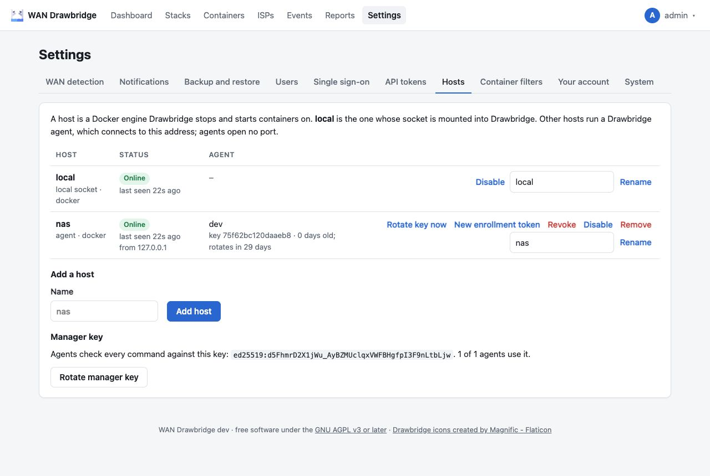

# Hosts and agents

A **host** is a Docker engine Drawbridge stops and starts containers on.
There is always one: **local**, the engine whose socket is mounted into
Drawbridge's container. Other Docker hosts each run a small **agent**, which
connects to Drawbridge and does what it asks.

Drawbridge itself is called the **manager** here. It never connects to an
agent: agents connect to the manager, at the same address as the web UI
(through your reverse proxy, or directly). Agent hosts need no open port, and
the manager needs no route to them.



## Tested so far

Agents are new. An agent on a second standalone Docker host has been set up
on a real host and works, connecting to Drawbridge through Traefik 3. The setups below have so far only been tested
inside Drawbridge's own test suite, against simulated Docker engines and
APIs, and not yet on real equipment, so expect rough edges and check the
first failover test closely:

- An agent reaching Drawbridge through a reverse proxy other than Traefik.
- A Docker Swarm.
- A Proxmox VE cluster. The token privileges below, especially those for
  HA, come from Proxmox's API documentation and have not been checked on a
  real cluster.
- A Kubernetes cluster: the manifest in `deploy/kubernetes` has not yet been
  applied to a real one.

Settings → Hosts marks these platforms **experimental**: on their tabs in the
examples shown after adding a host, and on each Swarm, Proxmox VE or
Kubernetes host in the list.

## Adding a Docker host

1. In **Settings → Hosts**, enter a name under **Add a host** and click **Add
   host**. A name is 1 to 32 letters, digits, dots, dashes or underscores,
   starting with a letter or digit, and must be unused. The host appears as
   **Waiting for the agent**.
2. Drawbridge shows how to run the agent, **once**, with the manager's
   address, the token and the manager key filled in. It has a tab per
   platform: **Docker host** (below), **Docker Swarm** (a stack file, see
   [Adding a Docker Swarm](#adding-a-docker-swarm)), **Proxmox VE (LXC)** (a
   Compose file with the `PROXMOX_` values to fill in, see [Adding Proxmox
   VE](#adding-proxmox-ve-lxc-containers)) and **Kubernetes** (the Secret for
   the manifest, see [Adding Kubernetes](#adding-kubernetes)). The Docker
   host tab:

   ```yaml
   services:
     drawbridge-agent:
       image: ghcr.io/zjcochran/wan-drawbridge:latest
       command: agent
       restart: unless-stopped
       volumes:
         - /var/run/docker.sock:/var/run/docker.sock
         - ./agent:/data/agent
       environment:
         DRAWBRIDGE_MANAGER: https://drawbridge.example.com
         DRAWBRIDGE_ENROLL_TOKEN: dbe_...
         DRAWBRIDGE_MANAGER_KEY: ed25519:...
         # DRAWBRIDGE_AGENT_ALLOW: media,downloads
   ```

3. Start it on the other host: `docker compose up -d`. Within a few seconds
   the host shows **Online**, and its stacks and containers appear on the
   Stacks and Containers pages with a **Host** column and filter.

The agent is the same image as Drawbridge, started with `command: agent`. It
runs no web UI, has no database and opens no port. Keep the agent's version
the same as the manager's: the Hosts page marks an agent whose version
differs.

| Variable | Meaning |
| --- | --- |
| `DRAWBRIDGE_MANAGER` | The manager's address, as your browser reaches the web UI. The Compose file uses `DRAWBRIDGE_BASE_URL` if it is set, otherwise the address of the page you are on |
| `DRAWBRIDGE_ENROLL_TOKEN` | A one-time token: it works **once**, within **one hour**. It is not needed after the agent enrolled, and is ignored then |
| `DRAWBRIDGE_MANAGER_KEY` | The manager's public key. The agent refuses to enroll if the manager it reaches has another key, so a wrong address or someone in between cannot take the agent over |
| `DRAWBRIDGE_AGENT_ALLOW` | Optional: a comma-separated list of stacks (Compose projects, Swarm stacks, Proxmox pools or Kubernetes namespaces). The agent then lists and acts on those only, whatever the manager asks; standalone containers are left out |
| `DRAWBRIDGE_AGENT_PLATFORM` | `docker` (default) for a Docker host, `swarm` for a whole Docker Swarm from a manager node (see [below](#adding-a-docker-swarm)), `proxmox` for the LXC containers of a Proxmox VE cluster (see [below](#adding-proxmox-ve-lxc-containers)), or `kubernetes` inside a cluster (see [below](#adding-kubernetes)) |
| `DRAWBRIDGE_AGENT_DIR` | Where the agent keeps its key and state; default `/data/agent`. Mount it, as above, so the agent keeps its identity across re-creation |
| `DOCKER_HOST` | The Docker engine; default `unix:///var/run/docker.sock` |
| `LOG_LEVEL` | `debug`, `info` (default), `warn` or `error`, as for the manager |

The token and key can also be made on the command line:
`drawbridge enroll-token <name>` (see [Command line](cli.md#enroll-token)).

If `DRAWBRIDGE_MANAGER` is plain `http://`, the agent logs a warning: requests
and commands are still signed, so they cannot be forged or replayed, but the
container list can be read on the way. Use HTTPS when the agent reaches the
manager over a network you do not control.

## Adding a Docker Swarm

One agent controls a whole swarm: its services, grouped by stack, plus the
standalone containers of the node it runs on. It must run on a **manager
node**, with `DRAWBRIDGE_AGENT_PLATFORM: swarm`. Add the host as above and open the
**Docker Swarm** tab, then deploy the agent as a stack, pinned to one manager node so its folder (and
with it its key) stays on that node:

```yaml
# docker stack deploy -c drawbridge-agent.yml drawbridge-agent
services:
  agent:
    image: ghcr.io/zjcochran/wan-drawbridge:latest
    command: agent
    volumes:
      - /var/run/docker.sock:/var/run/docker.sock
      - /srv/drawbridge-agent:/data/agent
    environment:
      DRAWBRIDGE_AGENT_PLATFORM: swarm
      DRAWBRIDGE_MANAGER: https://drawbridge.example.com
      DRAWBRIDGE_ENROLL_TOKEN: dbe_...
      DRAWBRIDGE_MANAGER_KEY: ed25519:...
    deploy:
      replicas: 1
      placement:
        constraints:
          - node.role == manager
          - node.hostname == manager-1
```

Use the manager's real hostname, and create `/srv/drawbridge-agent` on that
node. An agent on a node that is not a manager stops with "needs a swarm
manager node".

The agent is pinned to one node because its key lives in its folder: an
agent that moved to another node would have no key and need a new
enrollment token. If that node is down, the swarm host shows **Offline**
until it is back, like any other host.

How the swarm is controlled:

| | |
| --- | --- |
| What is listed | Every service, as "Swarm service" on the Containers page, grouped by its stack (`com.docker.stack.namespace`), with the key `stack/service`; services outside a stack use their name. Standalone containers on the agent's node are listed as on a Docker host. Containers that are tasks of a service are not listed. The agent's own service is left out. |
| Running | A service runs while at least one of its tasks runs. |
| Stopping a replicated service | It is scaled to 0. Its replica count is kept with the failover, and on the service as the label `drawbridge.replicas`. |
| Stopping a global service | It cannot be scaled, so it gets the placement constraint `node.labels.drawbridge-stopped==true`, which no node has: its tasks stop everywhere. |
| Starting | The replica count comes back (from the failover, else from the label, else 1), or the constraint is removed. |
| Order | Services have no `depends_on`, so they all stop and start at once. For the health wait, a service counts as healthy once all its tasks run. |
| Labels | `drawbridge.on-failover` works on a service's own labels (`deploy.labels` in a stack file). |
| Data used | Not measured for services: their tasks run on several nodes. Standalone containers are measured as usual. |

## Adding Proxmox VE (LXC containers)

One agent controls the LXC containers of a whole Proxmox VE cluster through
the Proxmox API. It needs no Docker socket. Run it anywhere that can reach
both the Proxmox API and Drawbridge: in a small LXC container or VM of the
cluster, or on a Docker host.

**1. Make a token that can only see and switch containers.** On a Proxmox
node, as root (the pool, `media` here, holds the containers Drawbridge may
control):

```sh
pveum role add DrawbridgeOps --privs "VM.Audit VM.PowerMgmt"
pveum user add drawbridge@pve --comment "WAN Drawbridge agent"
pveum user token add drawbridge@pve agent --privsep 1
pveum acl modify /pool/media --tokens 'drawbridge@pve!agent' --roles DrawbridgeOps
```

The third command prints the token's secret once. Give the role on more
pools, or on `/vms` for every guest. Containers under **HA** must be stopped
through HA, or HA starts them again. For that, the token also needs
`Sys.Audit` on `/` to see which containers HA manages, and `Sys.Console` on
`/` to change their HA state, for example with a second role. Without
`Sys.Audit`, Drawbridge sees no HA and stops every container directly.

**2. Note the API certificate's fingerprint**, from the Proxmox web UI
(node → System → Certificates, `pve-ssl.pem` or your own). If you leave it
out, the agent stops and prints the fingerprint the server presented, so you
can compare and set it.

**3. Add the host in Drawbridge and run the agent** with
`DRAWBRIDGE_AGENT_PLATFORM: proxmox`, as on the **Proxmox VE (LXC)** tab:

```yaml
services:
  drawbridge-agent:
    image: ghcr.io/zjcochran/wan-drawbridge:latest
    command: agent
    restart: unless-stopped
    volumes:
      - ./agent:/data/agent
    environment:
      DRAWBRIDGE_AGENT_PLATFORM: proxmox
      DRAWBRIDGE_MANAGER: https://drawbridge.example.com
      DRAWBRIDGE_ENROLL_TOKEN: dbe_...
      DRAWBRIDGE_MANAGER_KEY: ed25519:...
      PROXMOX_URL: https://pve.example.com:8006
      PROXMOX_TOKEN_ID: drawbridge@pve!agent
      PROXMOX_TOKEN_SECRET_FILE: /run/secrets/proxmox-token
      PROXMOX_FINGERPRINT: "AB:CD:…"
    secrets:
      - proxmox-token
secrets:
  proxmox-token:
    file: ./proxmox-token
```

| Variable | Meaning |
| --- | --- |
| `PROXMOX_URL` | The API of any node: `https://<host>:8006` |
| `PROXMOX_TOKEN_ID` | `user@realm!name` |
| `PROXMOX_TOKEN_SECRET` or `PROXMOX_TOKEN_SECRET_FILE` | The token's secret, or a file holding it (a Docker secret) |
| `PROXMOX_FINGERPRINT` | The API certificate's SHA-256 fingerprint, with or without colons. The agent trusts that certificate only, so a self-signed one works and nothing else can stand in for it |

The token stays on the agent: Drawbridge never sees it. At start the agent
lists the containers once, so a wrong token or fingerprint stops it at once
with the reason.

How the containers are controlled:

| | |
| --- | --- |
| What is listed | Every LXC container the token can see; VMs are left out. A container in a pool is in a stack named after the pool, keyed `pool/<vmid>`; one without a pool is standalone, keyed by its name ("CT 104" when it has none). The containers show "LXC" on the Containers page. A container whose name is the agent's hostname is the agent's own and is left out. |
| Labels | The Proxmox tags `drawbridge-stop` and `drawbridge-keep` work like the `drawbridge.on-failover` label. |
| Stopping | A shutdown, forced after the stop timeout (30 seconds), then Drawbridge waits for Proxmox's task. Under HA: HA's state is set to `stopped`, and Drawbridge waits until the container is stopped. |
| Starting | A start, waiting for the task; under HA, the state `started`, waiting up to 2 minutes. |
| Order | Within a pool, a container starts after those with a lower start order (the container's **Start/Shutdown order** option) and stops before them; containers without one start last. |
| Data used | Proxmox's `netin` and `netout` counters for running containers. |

## Adding Kubernetes

An agent inside the cluster controls its Deployments, StatefulSets,
DaemonSets and CronJobs. It connects out to Drawbridge, so the cluster needs
no Service or Ingress for it. Add the host in Drawbridge, replace the
Secret in
[`deploy/kubernetes/drawbridge-agent.yaml`](../../deploy/kubernetes/drawbridge-agent.yaml),
with the one on the **Kubernetes** tab, and `kubectl apply -f` it. The manifest's
[README](../../deploy/kubernetes/README.md) lists every object and
permission it creates, and how to limit the agent to some namespaces
(`DRAWBRIDGE_AGENT_ALLOW` then lists namespaces).

The agent uses its pod's ServiceAccount: Drawbridge never stores cluster
credentials, and the agent may only read workloads and autoscalers, scale
Deployments and StatefulSets, and patch DaemonSets and CronJobs. At start it
lists the workloads once, so missing permissions stop it at once with the
reason.

| | |
| --- | --- |
| What is listed | Deployments, StatefulSets, DaemonSets and CronJobs. A namespace is a stack; workloads are keyed `namespace/kind/name`, for example `media/deployment/web`, and show their kind on the Containers page. The agent's own Deployment (labelled `drawbridge.io/self: "true"`) is left out. |
| Labels | The label or annotation `drawbridge.on-failover: stop` or `keep` on the workload works as on Docker. |
| Running | Deployments and StatefulSets with more than 0 replicas wanted; DaemonSets with pods scheduled and not stopped by Drawbridge; CronJobs that are not suspended. |
| Stopping | Deployments and StatefulSets are scaled to 0 through their `scale` subresource; their replica count is kept with the failover. DaemonSets get the node selector `drawbridge.io/stopped: "true"`, which no node has, so their pods go away. CronJobs are suspended. |
| Starting | The replica count comes back (1 if it was lost), the node selector is removed, or the CronJob is resumed. For the health wait, a workload counts as healthy once all its replicas (or scheduled pods) are ready. |
| Order | Kubernetes has no dependencies between workloads, so all stop and start at once. |
| Warnings | A workload that a HorizontalPodAutoscaler targets, or that Argo CD or Flux manage, shows a warning on the Containers page: they undo the change. See the manifest's README for how to make Argo CD ignore it. |
| Data used | Not measured: it would need the agent to read node statistics, which is far more access than it should have. |

## What the Hosts page shows

| Column | Meaning |
| --- | --- |
| Host | The name, and whether it is the local socket or an agent, with its platform (`docker`). |
| Status | **Online**: the agent was in touch within the last 90 seconds. **Offline**: it was not; the time it was last seen and the error are shown. **Waiting for the agent**: a token was made and has not been used yet; it is valid until the time shown. **Revoked** and **Disabled**: below. Also: "N containers to start once it is back" when starts are owed to it. |
| Agent | The agent's version, its key's fingerprint (the first 16 hex digits of its SHA-256), how old the key is and when it rotates. |

Everyone can open the Hosts page; only admins see the buttons and the
manager key.

## Hosts that go offline

An agent polls the manager all the time. If it has not been in touch for 90
seconds, its host turns **Offline**, a `host_offline` event is recorded, and
notifications in the "Hosts" group are sent. Its containers stay on the
Stacks and Containers pages with their settings, shown as "host offline".
When it is back, `host_online` is recorded.

A host that is offline when a failover or failback runs is caught up with
once it is back; see [hosts that cannot be
reached](during-an-outage.md#hosts-that-cannot-be-reached).

## Actions

| Action | What it does |
| --- | --- |
| Rotate key now | The agent makes a new key at its next poll and replaces its old one (below). |
| New enrollment token | Shows the examples again, for every platform, with a new one-time token. The agent's current key stops working at once; the host waits for the agent to enroll again. Use it when an agent lost its folder, or after a revoke. |
| Revoke | The agent is refused from now on: its key is deleted. Its containers stay listed, as unknown, until you remove the host. |
| Disable / Enable | A disabled host is left out of every failover and failback, and its agent is told so. The local host can be disabled too. Enabling puts it back. |
| Forget owed starts | Shown when starts are owed to the host: Drawbridge will not start those containers. |
| Remove | Deletes the host, with its stack and container settings and any owed starts. Events and data-used history are kept. The local host cannot be removed. |
| Rename | Any host, the local one included. The name is used in events, notifications and `set-stack nas:media on` on the command line. |

Every action is recorded as an event (see [Monitoring](monitoring.md#event-types)).

## Keys

Each agent makes its own Ed25519 key when it first starts. The private key
never leaves the agent's folder; the manager only knows the public key.

- **Rotation.** The agent replaces its key every **30 days** by itself, and
  when you click **Rotate key now**. It sends the new key signed with the old
  one, with proof that it holds the new one. The manager accepts both keys
  until the agent first uses the new one, so a rotation cut short (a restart
  in the middle) cannot lock the agent out. A `host_key_rotated` event is
  recorded.
- **Expiry.** The manager refuses a key older than **90 days**: an agent that
  could not rotate for that long (because it was off) needs a new enrollment
  token. Seven days before, `host_key_expiring` is recorded and notified.
- **The manager's key.** Every command the manager sends is signed with the
  manager's key, which the agent pinned when it enrolled. **Rotate manager
  key** (under the host list) makes a new one: agents that are online get it
  at once, signed with the old key, and the others when they are back. The
  page shows how many agents use the current key. Old keys are deleted once no
  agent uses them. New examples carry the new key.

## What an agent can and cannot do

An agent only does these things, and only when the manager asks with a
command signed by the manager's key: list its containers, report one's state
and health, stop one, start one, read network counters, and rotate its own
key or pin a new manager key. It has no way to run a command in a container,
pull or create anything, or reach the Docker API in any other way. A
compromised manager can therefore only stop and start what the agent lists,
and `DRAWBRIDGE_AGENT_ALLOW` narrows that further.

The agent still has the Docker socket mounted, which gives full control of
that Docker host to anyone who takes over the agent's container, as for
Drawbridge itself.

## The agent's health check

The image's `HEALTHCHECK` runs `drawbridge healthcheck`. In an agent (when
`DRAWBRIDGE_MANAGER` is set) it passes when the agent reached the manager
within the last 90 seconds; Docker shows the container as unhealthy
otherwise.

## Through a reverse proxy

Agents use the paths under `/api/agent/v1/` at the manager's address, so a
proxy that forwards the web UI forwards them too. An agent keeps one request
open for up to 25 seconds while it waits for commands, well under the
60-second read timeout proxies use by default. See [Behind a reverse
proxy](reverse-proxy.md#agents).
