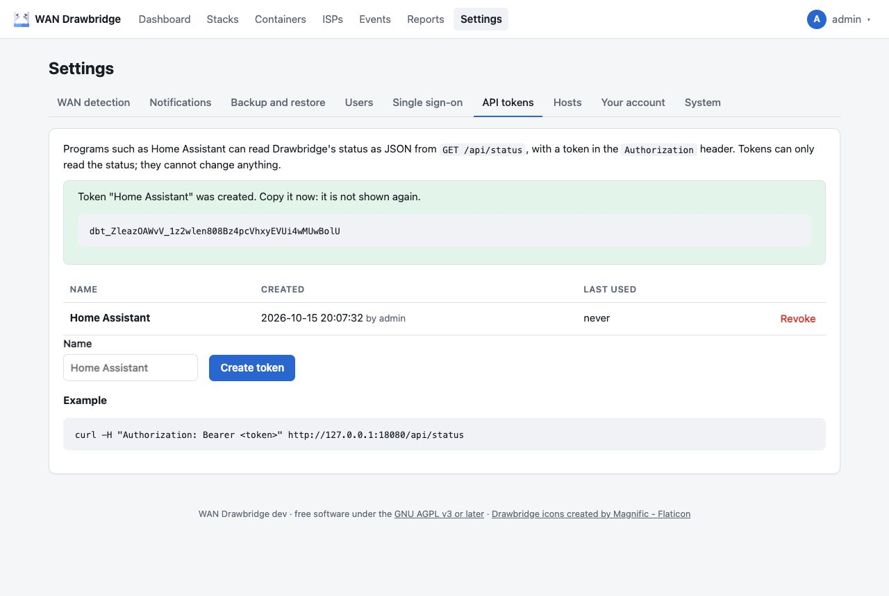

# Monitoring

Drawbridge offers five ways to watch it: Prometheus metrics, a JSON status
API, a health check, the event log, and its container log.

## Prometheus metrics

Metrics are **off** unless you set a token:

```yaml
environment:
  DRAWBRIDGE_METRICS_TOKEN: a-long-random-string
```

Then `GET /metrics` with `Authorization: Bearer <token>` returns the Prometheus
text format. Without the token set, `/metrics` returns 404; with a wrong or
missing token, 401.

Scrape configuration:

```yaml
scrape_configs:
  - job_name: drawbridge
    authorization:
      credentials: a-long-random-string
    static_configs:
      - targets: ["drawbridge:8080"]
```

### Metric reference

Counters count since Drawbridge started; they reset on restart, as Prometheus
expects.

| Metric | Type | Labels | Meaning |
| --- | --- | --- | --- |
| `drawbridge_build_info` | gauge | `version` | Always 1. |
| `drawbridge_wan_state` | gauge | `state` = `learning`, `primary`, `failover_pending`, `failover`, `failback_pending` | 1 for the current state, 0 for the others. |
| `drawbridge_state_since_timestamp_seconds` | gauge | | Unix time the current state began. |
| `drawbridge_on_primary` | gauge | | 1 when the last conclusive check was on the primary ISP. |
| `drawbridge_paused` | gauge | | 1 while automation is paused (including before the setup wizard is finished). |
| `drawbridge_isp_info` | gauge | `isp`, `asn`, `primary` | 1 for the ISP of the last conclusive check. Absent before the first one. |
| `drawbridge_last_check_timestamp_seconds` | gauge | | Unix time of the last check. |
| `drawbridge_last_check_duration_seconds` | gauge | | How long the last check took. |
| `drawbridge_checks_total` | counter | `result` = `conclusive`, `inconclusive` | Checks run. |
| `drawbridge_failovers_total` | counter | `trigger` = `auto`, `manual` | Failovers. |
| `drawbridge_failbacks_total` | counter | `trigger` = `auto`, `manual` | Failbacks (`manual` = Restore now). |
| `drawbridge_run_errors_total` | counter | | Container runs that ended with at least one error. |
| `drawbridge_flaps_total` | counter | | Failovers less than an hour after a failback. |
| `drawbridge_failback_hold_seconds` | gauge | | How long the primary must currently be stable before failback; grows while it flaps. |
| `drawbridge_pending_due_timestamp_seconds` | gauge | | When a pending failover or failback completes if nothing interrupts it; 0 when none is pending. |
| `drawbridge_containers_stopped` | gauge | | Containers Drawbridge stopped and has not started yet. |
| `drawbridge_host_up` | gauge | `host` | 1 when the host answered the last time Drawbridge listed it (every 30 seconds and before every failover and failback), 0 when it did not. |
| `drawbridge_backup_last_success_timestamp_seconds` | gauge | | When the last [scheduled backup](backup-and-restore.md#scheduled-backups) was written; 0 if none yet. |
| `drawbridge_notifications_total` | counter | `result` = `sent`, `failed` | Notification deliveries; `failed` counts those that failed after every retry. |
| `drawbridge_syslog_messages_total` | counter | `result` = `sent`, `dropped` | Only when [syslog](#sending-the-log-to-a-syslog-server) is on: log lines sent, and lines dropped because the queue was full. |
| `drawbridge_containers` | gauge | `on_failover` = `stop`, `keep` | Known containers by effective setting. |

### Alert rules

Drawbridge can also send these itself: see [Notifications](notifications.md).

```yaml
groups:
  - name: drawbridge
    rules:
      - alert: DrawbridgeOnBackupISP
        expr: drawbridge_wan_state{state="failover"} == 1
        for: 30m
        annotations:
          summary: "WAN on a backup ISP for 30 minutes; selected containers are stopped"

      - alert: DrawbridgeChecksFailing
        expr: time() - drawbridge_last_check_timestamp_seconds > 600
        annotations:
          summary: "Drawbridge has not completed a check in 10 minutes"

      - alert: DrawbridgeInconclusive
        expr: increase(drawbridge_checks_total{result="inconclusive"}[30m]) > 20
        annotations:
          summary: "Most WAN checks are inconclusive: the IP providers cannot be reached"

      - alert: DrawbridgeRunErrors
        expr: increase(drawbridge_run_errors_total[1h]) > 0
        annotations:
          summary: "Drawbridge failed to stop or start a container"

      - alert: DrawbridgePrimaryFlapping
        expr: drawbridge_failback_hold_seconds > 1200
        annotations:
          summary: "The primary ISP is flapping; failback waits {{ $value | humanizeDuration }}"

      - alert: DrawbridgeBackupStale
        expr: drawbridge_backup_last_success_timestamp_seconds > 0 and time() - drawbridge_backup_last_success_timestamp_seconds > 2 * 86400
        annotations:
          summary: "No scheduled backup has worked for two days"

      - alert: DrawbridgePaused
        expr: drawbridge_paused == 1
        for: 12h
        annotations:
          summary: "Drawbridge automation has been paused for 12 hours"
```

## JSON status API

`GET /api/status` returns the current state as JSON, for Home Assistant,
dashboards or scripts. It needs an API token:

1. As an admin, open **Settings → API tokens**, type a name (what will use
   it) and click **Create token**.
2. Copy the token (it starts with `dbt_`). It is shown once; Drawbridge keeps
   only its SHA-256 hash.
3. Send it as `Authorization: Bearer <token>`.



A missing, unknown or revoked token gets 401 with `WWW-Authenticate`. Tokens
can only read the status. The tab lists each token's name, who made it, when,
and when it was last used; **Revoke** deletes it at once. Making and revoking
tokens are recorded as `api_token_created` and `api_token_deleted` events.
Tokens are not in backup files: after a restore on a new host, make new ones.

```sh
$ curl -H "Authorization: Bearer dbt_..." http://drawbridge:8080/api/status
{
  "state": "failover",
  "state_label": "Failover",
  "since": "2026-10-14T15:17:34Z",
  "due": null,
  "current_isp": { "id": 2, "name": "SKYLINK", "asn": 64510, "metered": true },
  "primary_isp": { "id": 1, "name": "EXAMPLENET" },
  "public_ip": "198.51.100.20",
  "last_check": "2026-10-14T15:18:30Z",
  "conclusive": true,
  "paused": false,
  "paused_until": null,
  "failover_test_until": null,
  "busy": "",
  "stopped": ["media-db-1", "media-downloader-1"],
  "hosts": [
    { "name": "local", "platform": "docker", "status": "online",
      "last_seen": "2026-10-14T15:18:30Z", "containers": 14, "stopped": 2 }
  ],
  "version": "0.13.0"
}
```

| Field | Meaning |
| --- | --- |
| `state` | `learning`, `primary`, `failover_pending`, `failover` or `failback_pending` |
| `state_label` | The same as the dashboard shows it ("On primary", "Failover", ...) |
| `since` | When this state began |
| `due` | When a pending failover or failback completes if nothing interrupts it; `null` in other states |
| `current_isp` | The ISP of the last conclusive check, or `null`. `metered` is true when traffic on it counts as a failover: a metered backup. It is false for the primary and for an [unmetered backup](isps.md#metered-and-unmetered-backups) |
| `primary_isp` | The primary ISP, or `null` while none is known |
| `public_ip` | The public IP of the last conclusive check |
| `last_check` | When the last check ran, or `null` before the first |
| `conclusive` | Whether the last check was conclusive |
| `paused`, `paused_until` | Automation paused; `paused_until` is `null` when paused until resumed |
| `failover_test_until` | When a running failover test ends, or `null` |
| `busy` | `stopping`, `starting` or `applying` while containers are being changed, else `""` |
| `stopped` | Names of the containers Drawbridge has stopped and not yet started again; `[]` when none |
| `hosts` | Every host: `name`, `platform` (`docker`), `status` (`online` when it answered the last time Drawbridge listed it, `offline` when not), `last_seen` (when it last answered, or `null`), `containers` (known containers on it) and `stopped` (those Drawbridge has stopped and not yet started again) |
| `version` | Drawbridge's version |

Times are RFC 3339 in UTC. The response has `Cache-Control: no-store`.

A Home Assistant [RESTful](https://www.home-assistant.io/integrations/rest/)
example, with the token in `secrets.yaml` as
`drawbridge_auth: "Bearer dbt_..."`:

```yaml
rest:
  - resource: http://drawbridge:8080/api/status
    headers:
      Authorization: !secret drawbridge_auth
    scan_interval: 30
    sensor:
      - name: Drawbridge state
        value_template: "{{ value_json.state_label }}"
      - name: Drawbridge ISP
        value_template: "{{ value_json.current_isp.name if value_json.current_isp else 'unknown' }}"
    binary_sensor:
      - name: Drawbridge failover
        value_template: "{{ value_json.state in ['failover', 'failback_pending'] }}"
```

## Health status API

`GET /api/health` answers **200** when everything is fine and **503** when
something needs attention, so an uptime monitor (Uptime Kuma, Peekaping,
Gatus and the like) can alert on the status code alone. It takes the same
API token as `/api/status`, sent as `Authorization: Bearer <token>`; a
missing or unknown one gets 401.

```sh
$ curl -H "Authorization: Bearer dbt_..." http://drawbridge:8080/api/health
{
  "healthy": false,
  "state": "failover",
  "problems": [
    { "check": "failover", "message": "on a backup ISP since 2026-10-14T15:17:34Z" },
    { "check": "hosts", "message": "host nas is offline" }
  ]
}
```

`problems` is `[]` when healthy. The checks, in the order they are reported:

| Check | A problem when |
| --- | --- |
| `failover` | The state is `failover` or `failback_pending`: traffic is on a metered backup, or it is back on the primary but the wait before failback is still running. Not during a [failover test](during-an-outage.md#manual-controls), and not while a failover is only pending. |
| `checks` | The last WAN check is older than 3 × the check interval plus the check timeout (3 minutes 5 seconds with the defaults, 60 s and 5 s), or there has been no check that long since Drawbridge started. |
| `inconclusive` | The last check could not tell which ISP is in use, for example during a total outage. |
| `hosts` | A host is offline (one message per host). Disabled, revoked and not yet enrolled hosts are not problems. |
| `paused` | Automation is paused. |

To leave checks out, list them in `ignore`, comma-separated, for example
`/api/health?ignore=failover,paused` to alert only when Drawbridge itself is
in trouble. An unknown name gets 400. The response has `Cache-Control:
no-store`.

In an uptime monitor, use an HTTP monitor with the URL, `GET`, and the
header `{"Authorization": "Bearer dbt_..."}`; 200 counts as up. Peekaping's
form needs a body even for `GET`: choose the **Text** body encoding and leave
it empty.

## Health check

- `GET /healthz` returns `200 ok` whenever the web server runs. It needs no
  sign-in and is never redirected to the setup wizard.
- The image's Docker `HEALTHCHECK` runs `/drawbridge healthcheck` every 30
  seconds (5 second timeout, 20 second start period, 3 retries). It requests
  `/healthz` on the port from `DRAWBRIDGE_LISTEN` and exits 1 if that fails.

The health check says the process is up, not that checks succeed. Use
`drawbridge_last_check_timestamp_seconds` for that.

## Event types

Every change of state and every administrative action is recorded in the event
log (Events page, CSV export). `by` in the details is the user who acted.

| Event | When | Details |
| --- | --- | --- |
| `state_changed` | The state machine moved | `from`, `to`, `asn`, `name`, `isp` |
| `failover` | A failover was confirmed | `asn`, `name`, `isp`, `paused` if automation was paused |
| `failback` | A failback was confirmed | as above |
| `flapping` | A failover came within an hour of a failback | `flaps`, `failback_wait` |
| `run_failed` | Stopping, starting or updating containers ended with an error | `action` (`stopping`, `starting`, `applying`), `error` |
| `isp_new` | An ASN was seen whose ISP group did not exist yet | `isp`, `name`, `asn` |
| `manual_failover` | Fail over now | `from`, `to`, `by` |
| `manual_restore` | Restore now | `from`, `to`, `by` |
| `drill_started` | Test failover, by hand or scheduled (`by` = `schedule`) | `by`, `minutes`, `until` (RFC 3339, UTC) |
| `drill_skipped` | A [scheduled failover test](during-an-outage.md#scheduled-tests) did not run | `reason`, `by` (`schedule`) |
| `data_alert` | Containers passed an ISP's [data limit](isps.md#data-limits) during its outages | `scope` (`outage` or `month`), `isp`, `used`, `limit` (bytes) |
| `drill_ended` | A failover test ended: time up (`by=timer`), End test now, Restore now or a failover (`by=failover` when automatic) | `by`; `kept_stopped` when a failover took over |
| `paused`, `resumed` | Automation paused or resumed (finishing the wizard logs `resumed`; a timed pause ending logs `resumed` with `by=timer`) | `by`; `until` (RFC 3339, UTC) on a timed pause |
| `primary_learned` | The learner chose a primary | `isp` |
| `primary_pinned` | A primary was pinned in the wizard or by `DRAWBRIDGE_PRIMARY_ASN` | `isp`, `asn` or `by` |
| `primary_undecided` | Learning ended without a clear primary | `shares` |
| `primary_suggested` | Another ISP now looks primary | `isp`, `current` |
| `relearn` | Re-learn primary ISP | `by` |
| `isp_role` | An ISP's role was changed in the UI | `isp`, `role`, `by` |
| `api_token_created`, `api_token_deleted` | An API token was made or revoked in Settings → API tokens | `name`, `by` |
| `isp_metered` | An ISP's Metered switch was changed in the UI | `isp`, `metered`, `by` |
| `isp_data_limits` | An ISP's [data limits](isps.md#data-limits) were saved in the UI | `isp`, `outage_bytes`, `month_bytes` (0 is off), `by` |
| `asn_moved` | An ASN was moved to another ISP in the UI | `asn`, `isp`, `by` |
| `stack_policy` | A stack switch was flipped | `host`, `stack`, `disable`, `by` |
| `container_policy` | A container setting changed | `host`, `container`, `policy`, `converted_stack`, `by` |
| `settings_changed` | Detection settings or container filters saved in Settings | `by` |
| `user_created` | A user was added: in the setup wizard (`by` = `setup`), by an admin, or by single sign-on (`by` = `sso`) | `user`, `role`, `by` |
| `user_disable`, `user_enable`, `user_delete`, `user_password` | User operations in Settings → Users | `user_id`, `by` |
| `user_role` | An admin changed a role in Settings → Users, or single sign-on changed it through the admin group (`by` = `sso groups`) | `user`, `role`, `by` |
| `password_changed` | A user changed their own password | `user` |
| `two_factor_on` | A user turned on two-factor sign-in | `user` |
| `two_factor_off` | Two-factor sign-in was turned off: by the user, by an admin in Settings → Users, or by linking single sign-on (`by` = `sso link`) | `user`, `by` |
| `recovery_codes_new` | A user made new recovery codes | `user` |
| `recovery_code_used` | Someone signed in with a recovery code | `user`, `left` |
| `sso_settings` | Single sign-on settings saved | `enabled`, `sso_only`, `by` |
| `sso_linked`, `sso_unlinked` | An account was linked to or unlinked from single sign-on | `user`; `sso_user` when linked |
| `notifications_changed` | A notification channel was added, changed or deleted | `channel`, `action` (`added`, `updated`, `deleted`), `by` |
| `backup_created` | A backup file was downloaded, or a scheduled one written (`by` = `schedule`) | `history` (`none`, `30d`, `60d`, `90d`, `all`), `by`; `file` for scheduled ones |
| `backup_failed` | A scheduled backup could not be written | `error`, `by` (`schedule`) |
| `backup_schedule` | The backup schedule was saved | `enabled`, `time`, `keep`, `history`, `by` |
| `test_schedule` | The failover test schedule was saved | `enabled`, `every`, `weekday`, `day`, `time`, `minutes`, `by` |
| `backup_restored` | A backup file was restored (in Settings, or in the setup wizard with `by` = `setup`) | `created`, `app_version`, `history`, `by` |
| `host_added` | A host was added in Settings → Hosts | `host`, `by` |
| `host_enrolled` | An agent used its one-time token | `host`, `platform`, `version`, `address`, `key` (fingerprint) |
| `host_enroll_token` | A new enrollment token was made for a host | `host`, `by` |
| `host_offline` | An agent was not in touch for 90 seconds | `host`, `last_seen` (RFC 3339, UTC) |
| `host_online` | An offline host's agent was in touch again | `host` |
| `host_key_rotated` | An agent replaced its key | `host`, `key` (fingerprint of the new key) |
| `host_key_expiring` | An agent's key is within 7 days of the 90-day limit | `host`, `expires` (RFC 3339, UTC) |
| `agent_refused` | An agent request was refused for a bad signature, a clock more than 5 minutes off, or a key older than 90 days; at most once an hour per host | `host`, `reason` |
| `host_revoked`, `host_removed` | A host was revoked or removed | `host`, `by` |
| `host_disabled`, `host_enabled` | A host was disabled or enabled | `host`, `by` |
| `host_renamed` | A host was renamed | `host`, `from`, `by` |
| `pending_forgotten` | Forget owed starts, in Settings → Hosts | `host`, `containers`, `by` |
| `manager_key_rotated` | Rotate manager key | `key` (its ID), `by` |

Changes made with the command line are not recorded as events.

Events are kept indefinitely; only individual checks are pruned (see
[Data model → retention](../technical/data-model.md#retention)).

## Logs

Drawbridge logs to standard error in `key=value` form, and optionally to a
[syslog server](#sending-the-log-to-a-syslog-server):

```sh
docker compose logs -f drawbridge
```

`LOG_LEVEL` is `debug`, `info` (default), `warn` or `error`. At `debug`, every
check is logged with its IP, ASN, ISP and state. Useful messages:

| Message | Level | Meaning |
| --- | --- | --- |
| `state changed` | info | Every state change, with the ISP. |
| `failover: stopping containers` / `failback: starting containers` | info | A run started, with the count. |
| `container action failed` | error | Docker refused to stop or start a container. |
| `check inconclusive` | info | Providers did not agree or could not be reached; lists each provider's result. |
| `primary ISP is flapping: waiting longer before failback` | warn | With the new wait. |
| `no ISP is clearly primary; pin one on the ISPs page` | warn | Learning ended undecided. |
| `failed sign-in` | warn | With user and client IP. |
| `cannot reach Docker; is /var/run/docker.sock mounted?` | error | At start-up. |
| `docker event stream ended; reconnecting` | warn | Docker restarted; Drawbridge reconnects every 5 seconds. |

### Sending the log to a syslog server

Set `DRAWBRIDGE_SYSLOG` and Drawbridge also sends every log line to a syslog
server; it keeps logging to standard error as before. It is off unless set.

```yaml
services:
  drawbridge:
    hostname: drawbridge # the HOSTNAME field of each message
    environment:
      DRAWBRIDGE_SYSLOG: tls://syslog.example.com:6514
      # DRAWBRIDGE_SYSLOG_FORMAT: rfc3164
      # DRAWBRIDGE_SYSLOG_FACILITY: local0
      # DRAWBRIDGE_SYSLOG_CA_FILE: /data/syslog-ca.pem
```

| Variable | Default | Meaning |
| --- | --- | --- |
| `DRAWBRIDGE_SYSLOG` | off | `udp://host[:port]`, `tcp://host[:port]` or `tls://host[:port]`. Default ports: 514 for UDP and TCP, 6514 for TLS. `host` is a name, an IPv4 address or an IPv6 address in brackets. |
| `DRAWBRIDGE_SYSLOG_FORMAT` | `rfc5424` | `rfc5424` or `rfc3164` (the older BSD format, for receivers that need it). |
| `DRAWBRIDGE_SYSLOG_FACILITY` | `daemon` | `kern`, `user`, `mail`, `daemon`, `auth`, `syslog`, `lpr`, `news`, `uucp`, `cron`, `authpriv`, `ftp`, or `local0` to `local7`. |
| `DRAWBRIDGE_SYSLOG_CA_FILE` | none | `tls://` only: a PEM file of CA certificates to trust besides the system ones, for a server with a private CA. Mount it into the container. |

A wrong value stops start-up with the problem listed, like any other setting.

**What is sent.** The same lines, at the same `LOG_LEVEL`, without the time
and level (the syslog header carries both). Only the server sends to syslog;
`drawbridge` commands such as `status` log to the terminal only.

```text
RFC 5424: <30>1 2026-03-04T05:06:07.890000Z drawbridge drawbridge - - - msg="state changed" from=primary to=failover_pending asn=64510 name=SKYLINK-64510 isp=SKYLINK
RFC 3164: <30>Mar  4 05:06:07 drawbridge drawbridge: msg="state changed" from=primary to=failover_pending asn=64510 name=SKYLINK-64510 isp=SKYLINK
```

- HOSTNAME is the container's host name: set `hostname:` in the Compose
  file, or Docker's random container ID is used. APP-NAME is `drawbridge`.
- The RFC 5424 time is UTC with microseconds; RFC 3164 has no time zone, so it
  is the container's local time (`TZ`).
- Severity follows the level: `debug` → 7 (debug), `info` → 6
  (informational), `warn` → 4 (warning), `error` → 3 (error). The priority is
  facility × 8 + severity.
- Framing: one message per datagram over UDP. Over TCP and TLS, RFC 5424
  messages are octet-counted (`<length> <message>`, RFC 6587 and RFC 5425)
  and RFC 3164 messages end with a newline.

**Delivery.** Lines wait in a queue of 1024 and are sent in order on one
connection. Logging never waits for the server:

- If the server cannot be reached, Drawbridge logs `syslog: cannot connect;
  retrying` once to standard error, and tries again after 1 second, then twice
  as long each time up to 30 seconds. When it connects it logs `syslog:
  connected again`. Connecting, including the TLS handshake, times out after
  10 seconds, and so does sending one line.
- While the queue is full, new lines are dropped and counted in
  `drawbridge_syslog_messages_total{result="dropped"}`.
- A line whose sending fails is sent again on the new connection. A line
  written just as the server closes the connection can still be lost, since
  TCP reports the broken connection only on a later write; over UDP,
  Drawbridge cannot tell whether a datagram arrived.
- At shutdown, lines still queued are sent for up to 2 seconds if the server
  is connected.

TLS is version 1.2 or later and checks the server's certificate and name
against the system CAs and `DRAWBRIDGE_SYSLOG_CA_FILE`. There is no client
certificate. UDP and TCP are not encrypted: log lines include usernames,
client IPs and your public IP, so use TLS across a network you do not trust.
