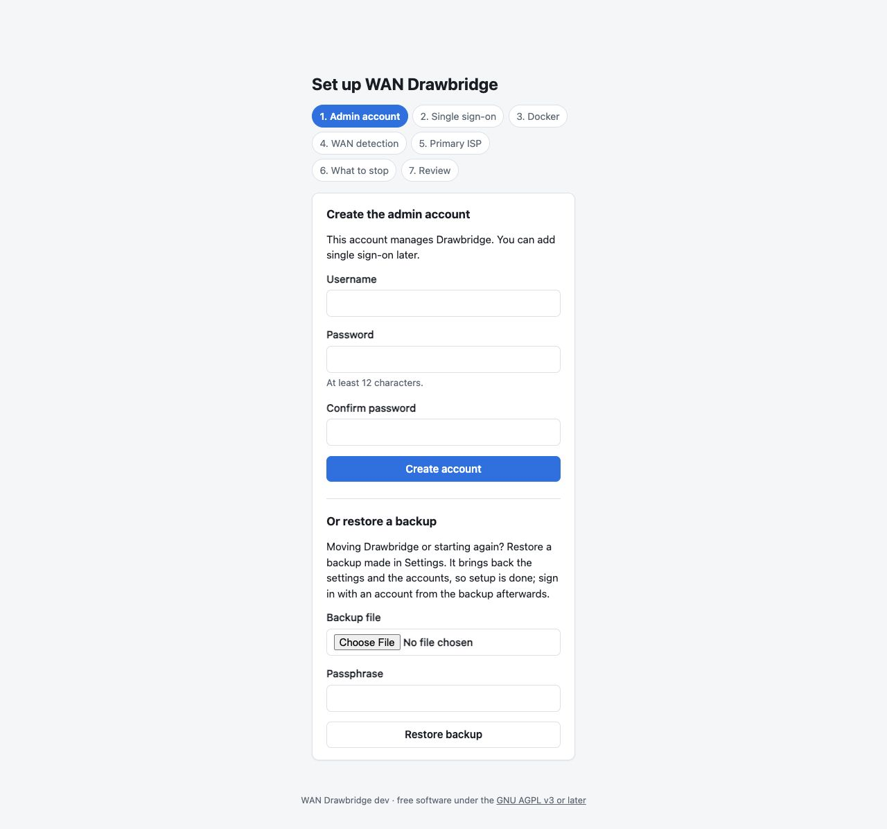
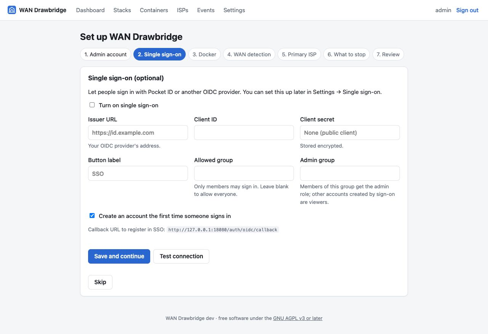
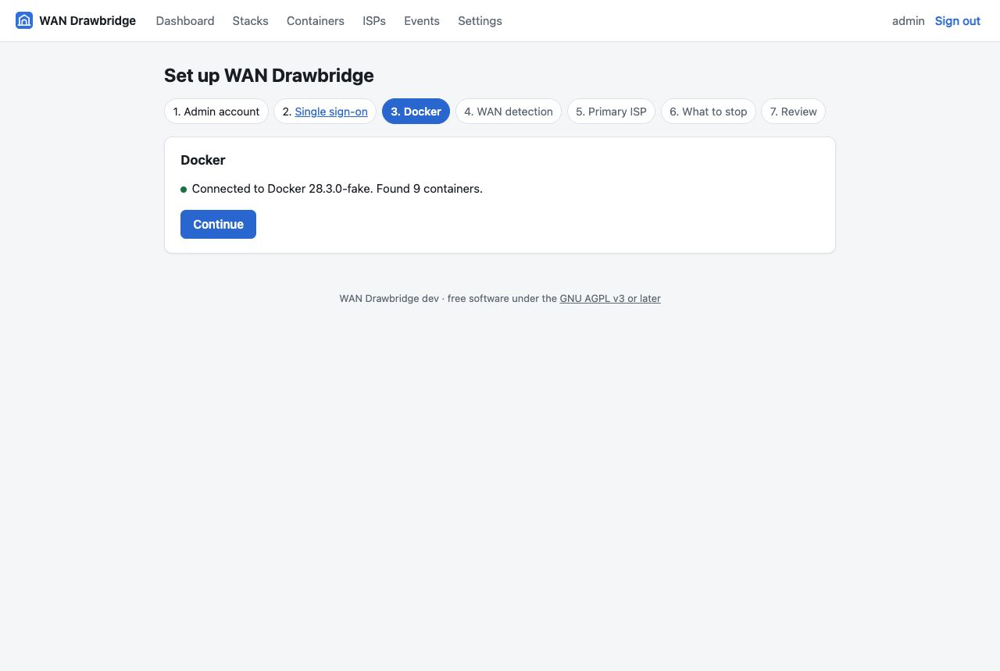
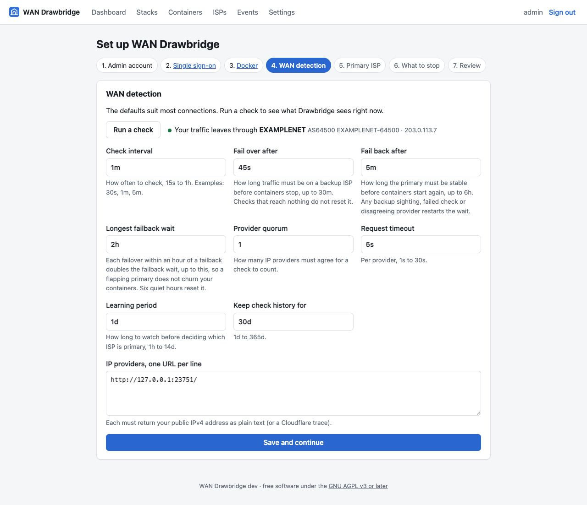
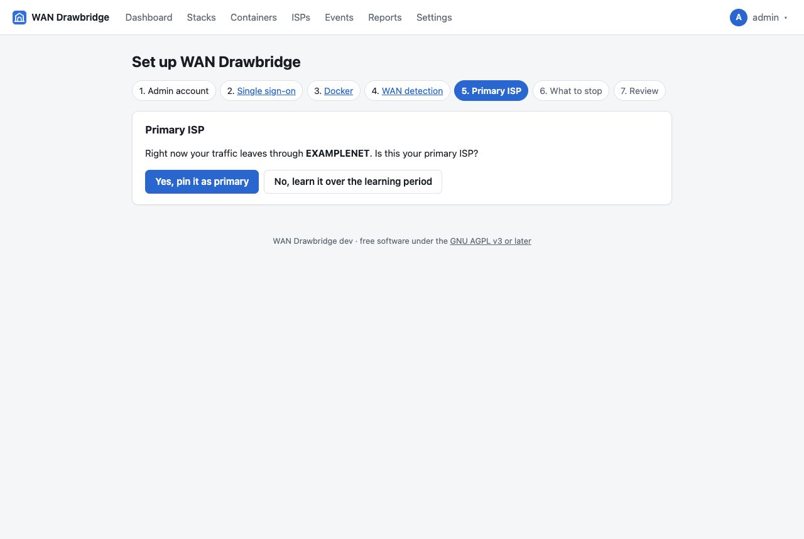
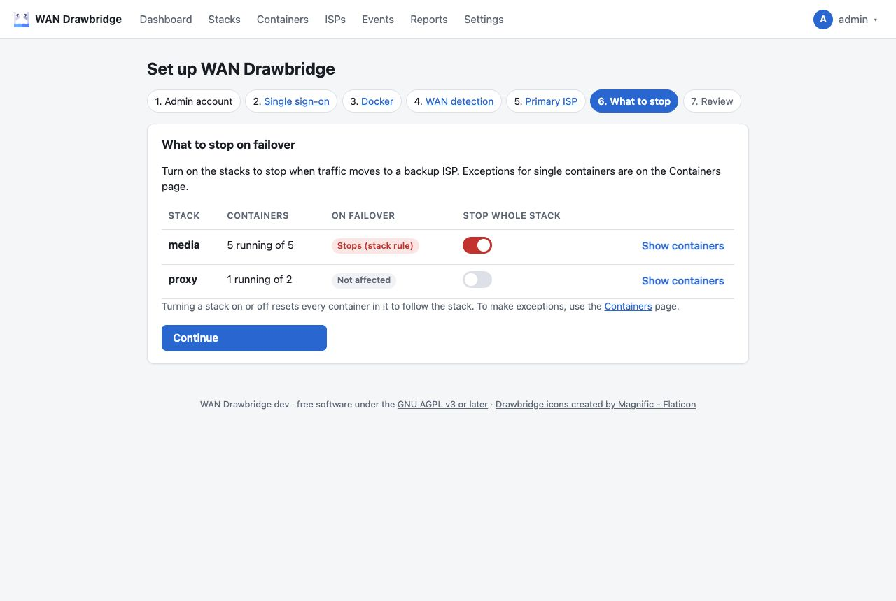
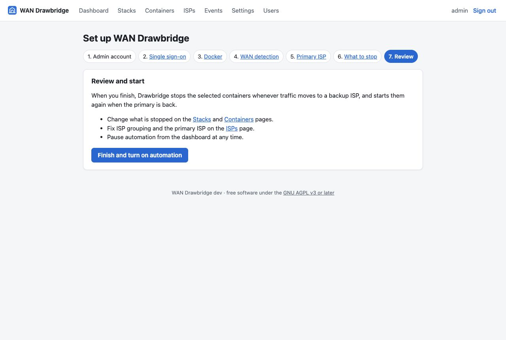

# Setup wizard

The first time you open Drawbridge, every page redirects to `/setup`. The
wizard has seven steps. Until you finish the last one, **automation is off**:
Drawbridge runs checks and records what it sees, but never stops or starts a
container.

You can leave the wizard at any time and come back to `/setup`; steps you have
completed are links in the step bar.

## 1. Admin account



Create the first administrator. The password must be at least 12 characters.
After this step:

- You are signed in.
- Step 1 cannot be repeated: once any user exists, `POST /setup/admin` is
  refused, so nobody else can create an admin through the wizard.

### Or restore a backup

Instead of creating an admin, you can restore a
[backup file](backup-and-restore.md#backup-files) made in Settings: choose the
file, enter its passphrase and click **Restore backup**. This brings back the
settings, ISPs, stack and container choices, users and single sign-on (and the
history, if the backup has any), and **finishes setup**: you go to the sign-in
page and sign in with an account from the backup. If the restore fails, the
reason is shown above the form and nothing changes.

Like creating the admin, this works without signing in, and only while no
user exists.

## 2. Single sign-on (optional)



Fill this in to let people sign in with Pocket ID or another OIDC provider, or
click **Skip**. Everything here can be changed later under **Settings → Single
sign-on**; see [Single sign-on](single-sign-on.md) for each field. The callback
URL to register with your provider is shown under the form.

"Turn off password sign-in" is not offered in the wizard: you must link your
own account first, which you do from Settings once the wizard is done.

## 3. Docker



Drawbridge checks that it can reach the Docker API and shows the engine
version and how many containers it found. If it cannot, it shows the error
and the volume line to add:

```yaml
volumes:
  - /var/run/docker.sock:/var/run/docker.sock
```

Fix the mount, recreate the container (`docker compose up -d`) and click
**Test again**. **Skip for now** lets you continue without Docker, but nothing
can be stopped until it is connected.

## 4. WAN detection



**Run a check** asks the IP providers for your public IP right now and shows
the result: the ISP your traffic leaves through, its ASN and the IP. If it
says the check was inconclusive, the providers could not be reached or did
not agree; see [Troubleshooting](troubleshooting.md#every-check-is-inconclusive).

The form below holds the detection settings. The defaults suit most homes:

| Setting | Default | Meaning |
| --- | --- | --- |
| Check interval | `1m` | How often to check while nothing is changing (15s – 1h). While a change is being confirmed, Drawbridge checks every 15 seconds (or at the interval, if it is shorter). |
| Fail over after | `45s` | How long traffic must be on a backup ISP before containers stop (0 – 30m). |
| Fail back after | `5m` | How long the primary must be stable before containers start again (0 – 6h). |
| Longest failback wait | `2h` | The most the failback wait can grow to while the primary is flapping (0 – 24h, at least "Fail back after"). |
| Provider quorum | `2` | How many IP providers must report the same IP for a check to count. |
| Request timeout | `5s` | Per provider (1s – 30s). |
| Learning period | `1d` | How long to watch before choosing a primary ISP on its own (1h – 14d). Not used if you pin one in the next step. |
| Keep check history for | `30d` | How long individual checks are kept (1d – 365d). |
| IP providers | Cloudflare, ipify, icanhazip | One URL per line; see [WAN detection](../technical/wan-detection.md#ip-providers). |

Durations accept `s`, `m`, `h` and `d`. **Save and continue** validates every
field and lists all problems at once.

## 5. Primary ISP



Drawbridge shows the ISP your traffic is using right now and asks whether it is
your primary:

- **Yes, pin it as primary** makes it the primary immediately. Drawbridge never
  changes a pinned primary on its own. Choose this when you are on your normal
  connection, which is almost always the case during setup.
- **No, learn it over the learning period** leaves the primary unknown. After
  the learning period (default one day), the ISP that carried at least 60% of
  your traffic time over the last 7 days becomes primary. No containers are
  stopped while the primary is unknown.

If no check has identified your ISP yet, use **Check again** or choose to learn.
See [ISPs and the primary ISP](isps.md) for the details.

## 6. What to stop



Every Docker Compose project Drawbridge found is listed as a stack. Turn a stack
on to stop all of its containers during a failover. Standalone containers
(started without Compose) and exceptions inside a stack are set on the
**Containers** page after the wizard. See
[Choosing what to stop](stacks-and-containers.md).

## 7. Review



**Finish and turn on automation**:

1. records that setup is complete,
2. turns automation on (the `resumed` event is logged), and
3. brings containers in line with the current state. Normally you are on the
   primary ISP and nothing happens. While the wizard was open, Drawbridge kept
   checking and moving through its states without acting; so if it already
   reached **Failover** (traffic on a backup for longer than "Fail over
   after"), finishing stops the selected containers straight away. A pending
   failover or failback simply continues its countdown.

You land on the dashboard with "Setup complete. Automation is on."

## Running the wizard again

There is no reset button, and none is needed: every wizard setting is also
on a regular page.

| Wizard step | Where to change it later |
| --- | --- |
| Admin account | Users (add admins), Settings → Your sign-in (password) |
| Single sign-on | Settings → Single sign-on |
| WAN detection | Settings → WAN detection |
| Primary ISP | ISPs |
| What to stop | Stacks and Containers |
