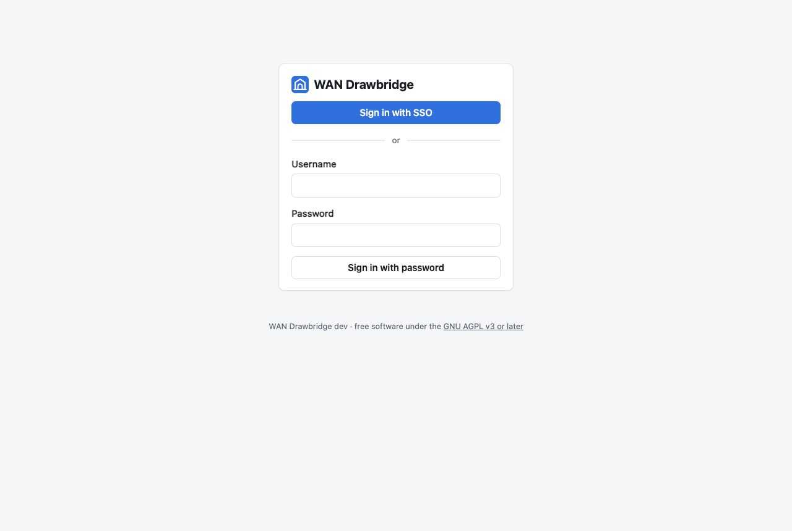

# Single sign-on

Drawbridge can let people sign in with [Pocket ID](https://pocket-id.org) or
any other OpenID Connect (OIDC) provider, alongside or instead of passwords.

## How it works in brief

- The sign-in page shows a **Sign in with SSO** button. The label is
  configurable, for example "Sign in with Pocket ID".
- Drawbridge uses the authorization code flow with PKCE, and checks the ID
  token's signature, audience, issuer and nonce.
- Accounts are matched on the provider's **issuer and subject** (the stable
  user ID), never on username or email. An SSO user called `alice` is not
  the same account as a local user `alice` until you link them.
- Drawbridge requests the scopes `openid profile email groups`.

## 1. Register Drawbridge with Pocket ID

In Pocket ID, open **OIDC Clients → Add OIDC Client**:

| Field | Value |
| --- | --- |
| Name | `WAN Drawbridge` |
| Callback URLs | The URL shown in Drawbridge under **Settings → Single sign-on**, "Callback URL to register", for example `https://drawbridge.example.com/auth/oidc/callback` |
| Public client | Off (recommended), so Pocket ID issues a client secret. On also works: Drawbridge uses PKCE and can sign in without a secret. |
| PKCE | On |

Save, and copy the **client ID** and **client secret**.

The callback URL comes from `DRAWBRIDGE_BASE_URL` when it is set; otherwise
from the address you are using to view Drawbridge. Behind a reverse proxy, set
`DRAWBRIDGE_BASE_URL` (see [Behind a reverse proxy](reverse-proxy.md)) so the
URL is the public one, and register exactly that.

### Groups (optional)

To use the allowed-group or admin-group options, create the groups in Pocket
ID (for example `drawbridge-users` and `drawbridge-admins`), add users, and
make sure group membership is released to the client. Pocket ID includes a
`groups` claim when the `groups` scope is requested. Drawbridge reads groups
from the ID token, or from the userinfo endpoint if the token has none.

## 2. Configure Drawbridge

**Settings → Single sign-on** (admins), or step 2 of the setup wizard:

| Field | Meaning |
| --- | --- |
| Turn on single sign-on | Shows the button on the sign-in page and enables the sign-in routes. |
| Issuer URL | Your OIDC provider's address, for example `https://id.example.com`. Drawbridge loads `/.well-known/openid-configuration` from it. A trailing slash is removed. |
| Client ID | From your provider. |
| Client secret | From your provider. Stored encrypted. Leave blank to keep the saved one; tick "Remove the saved client secret" to delete it. |
| Button label | Provider name on the sign-in button and in messages, for example "Pocket ID"; default "SSO". |
| Allowed group | If set, only members of this group may sign in. Others see "Your SSO account is not in the "…" group." (with the button label in place of SSO) |
| Admin group | If set, members get the admin role; see below. |
| Create an account the first time someone signs in | On by default. Off means only people whose accounts are already linked can sign in. |
| Turn off password sign-in | Makes single sign-on the only way in. See [SSO only](#sso-only). |

**Test connection** checks that the issuer's discovery document loads, without
saving: "✓ Found https://id.example.com (sign-in at …)" or "✗" with the error.

Save. The sign-in page now offers the button:



## What happens when someone signs in

1. If an account is already linked to their SSO identity, they are signed
   in. If that account is disabled, they are refused.
2. Otherwise, if account creation is on, Drawbridge creates an account:
   - **Username:** `preferred_username`, else the email address, else the
     subject. If the name is taken, a number is added: `alice-2`, `alice-3`, ….
   - **Role:** admin if they are in the admin group, otherwise viewer.
   - The account has no password; it signs in only through single sign-on.
3. Otherwise they see "No Drawbridge account is linked to your SSO
   account. Ask an admin to add you."

### Admin group, precisely

- **New accounts** created by single sign-on get admin if they are in the admin
  group, viewer if not.
- **Existing accounts created by single sign-on** (no password) follow the
  group at every sign-in: added to the group, they become admin; removed, they
  become viewer. The change is logged as a `user_role` event. The last admin is
  never demoted.
- **Accounts with a password** (local accounts, including linked ones) keep the
  role an admin gave them; the group does not change them.

## Linking an existing account

To use single sign-on for an account that already has a password (your own
admin account, typically):

1. Sign in with your password.
2. **Settings → Your sign-in → Link my SSO account.**
3. Sign in at your provider. You return to Settings with "SSO account
   linked."

The account can now sign in either way. **Unlink** removes the link (only
offered when the account also has a password, so you cannot lock yourself out).

One SSO identity can be linked to only one Drawbridge account.

## SSO only

"Turn off password sign-in" hides the username and password fields and refuses
password sign-ins. To protect you from locking yourself out, Drawbridge only
accepts this setting when **your own account is linked**.

### If your provider is unreachable

Your WAN might be on a backup ISP exactly when you need Drawbridge, and Pocket
ID might be behind that same connection. If you cannot sign in:

1. Set `DRAWBRIDGE_LOCAL_LOGIN=force` in the Compose file and recreate the
   container (`docker compose up -d`). Password sign-in works again, whatever
   the setting says. Drawbridge logs a warning at start-up while it is set.
2. Sign in with a password. If you have none (an SSO-only account), set one
   from the host:

   ```sh
   echo 'a new long password' | docker compose exec -T drawbridge /drawbridge reset-password alice
   ```

3. Remove `DRAWBRIDGE_LOCAL_LOGIN` again when your provider is back.

## Security notes

- The client secret is encrypted with AES-256-GCM before it is stored. The key
  is `DRAWBRIDGE_SECRET_KEY` if set, otherwise a random key generated into
  `/data/db/secret.key`. Back up that file with the database; without it the
  saved secret cannot be decrypted and must be entered again.
- A sign-in must be completed within 10 minutes and can be used once.
  Sign-ins in progress are lost if Drawbridge restarts.
- Signing out of Drawbridge does not sign you out of your provider.
- Details: [Security](../technical/security.md#single-sign-on).

## Other providers

Any OIDC provider that supports discovery and the authorization code flow
works the same way (Authelia, Authentik, Keycloak, Kanidm, Zitadel, …):

- Register the callback URL.
- Make sure the provider can include a `groups` claim if you use the group
  options. Some call the scope differently; Drawbridge always requests
  `groups`, and a provider that does not know that scope may ignore it or
  reject the request.
- The issuer URL must match the `iss` claim exactly.
