# Using the web UI

The web UI is a set of server-rendered pages that update themselves live: when
the WAN state changes or a container starts or stops, open pages refresh the
affected part within a second, without reloading. It follows your system's
light or dark mode, in the colour theme you choose (see [Appearance](#appearance)).

The pages are listed in a sidebar on the left. Above them, **Search or jump
to…** (or ⌘K, Ctrl+K elsewhere) opens a box that finds pages, Settings tabs,
stacks and containers as you type; arrow keys choose and Enter opens. A stack
or container opens the Stacks page searched for it. Your picture and username sit at
its foot: click them for a menu with **Your account** (Settings → Your account)
and **Sign out**; a click elsewhere or Escape closes it.

On a phone (a screen narrower than 48rem) the name and your picture sit in a bar
along the top, and the pages are a tab bar along the bottom: **Dashboard**,
**Stacks**, **Containers**, **ISPs** and **More**, which opens **Events**,
**Reports** and **Settings**. The tab bar keeps clear of the notch and the home
indicator.

A phone can add Drawbridge to its home screen (Safari: Share, then **Add to
Home Screen**; Chrome: **Install app** or **Add to Home screen**). It then opens
full screen with its own icon, named "Drawbridge", without the browser's
address bar.

There are two roles:

- **Admins** can change everything.
- **Viewers** see every page, but in Settings only the **WAN detection**
  (read-only), **Your account** and **System** tabs. They can change only their
  own password, single sign-on link and appearance. Controls they cannot use
  are not shown.

Every page footer shows the version, the licence (AGPL-3.0-or-later) and a
link to the source code, as the AGPL requires.

On a phone, Drawbridge can be added to the home screen (Safari: Share, then
**Add to Home Screen**; Chrome: **Install app** or **Add to Home screen**). It
then opens full screen with its own icon, named "Drawbridge", without the
browser's address bar.

## Dashboard

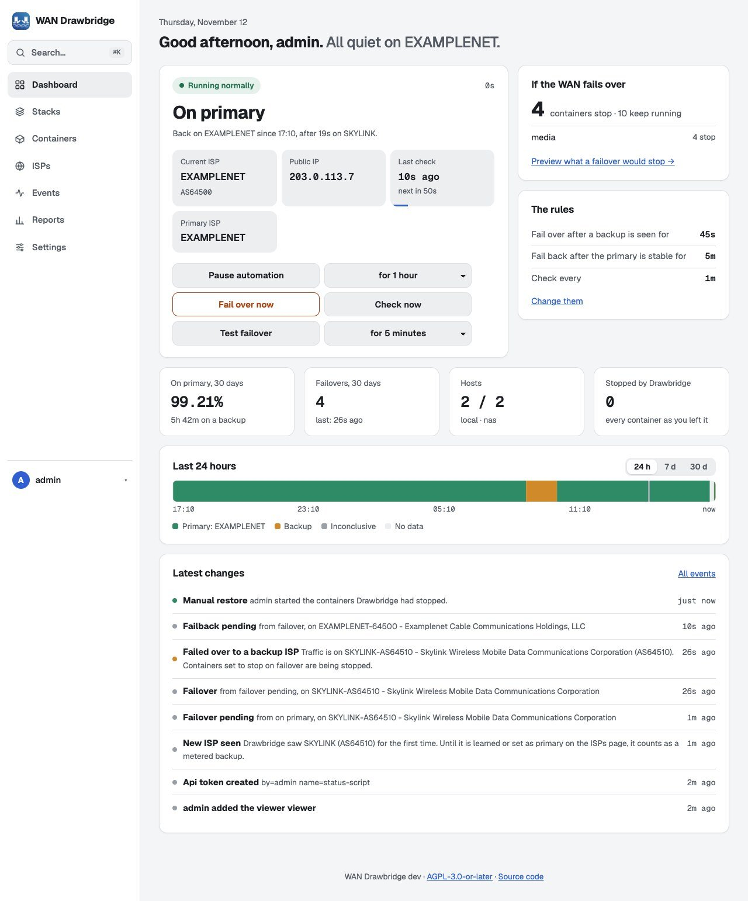

The page opens with the date, a greeting by the server's time of day, and one
sentence on where things stand ("All quiet on EXAMPLENET.", "On SKYLINK since
14:02.").

Under the status card, four tiles cover the last 30 days and now:

| Tile | Meaning |
| --- | --- |
| On primary, 30 days | The share of the last 30 days not in a failover, and the time on a backup. |
| Failovers, 30 days | Outages that started in the last 30 days, and how long ago the newest started. |
| Hosts | Hosts up out of those not disabled (the local host always counts as up), and their names. |
| Stopped by Drawbridge | Containers Drawbridge has stopped now. |

Beside the status card:

- **If the WAN fails over**: how many containers would stop and how many keep
  running, by their settings now, with the stacks they are in; and a link to the
  [failover preview](#failover-preview). While a failover run is open, or starts
  are owed to an unreachable host, **Stopped by Drawbridge** (below) takes its
  place.
- **The rules**: the failover delay, the failback delay and the check
  interval, with a link to change them (admins).

### Status card

The large card at the top shows the state as a coloured badge and a heading,
with the time in this state at the right:

| Heading | Badge | Meaning |
| --- | --- | --- |
| Learning | Learning (grey) | No primary ISP is known yet. Nothing is stopped. |
| On primary | Running normally (green) | Traffic leaves through the primary ISP. |
| Failover pending: *ISP* | Change pending (amber) | Traffic is on a backup ISP; Drawbridge is confirming it. Shows "Failing over in 32s unless the primary returns." |
| On backup: *ISP* | Failover: containers stopped (amber, with an amber edge on the card) | Confirmed on a backup. Selected containers are stopped. |
| Failback pending | Change pending (amber) | The primary is back; Drawbridge is making sure it stays. Shows "Failing back in 4m 56s if the primary stays stable." |

While automation is paused the badge reads **Paused**. Under the heading, on
the primary after an outage: "Back on EXAMPLENET since 14:27, after 25m on
SKYLINK." (with the date when it was not today); in a failover, when the
containers start again.

Badges next to it:

- **Paused**: automation is paused; states still change but no container is
  touched.
- **stopping containers / starting containers / applying containers**: a
  container run is in progress.

If the primary ISP has been flapping, a banner explains how long failback now
waits (see [flapping](during-an-outage.md#flapping)).

The tiles below the heading:

| Tile | Meaning |
| --- | --- |
| Current ISP | The ISP of the last conclusive check, with the ASN that announced the IP. |
| Primary ISP | The primary, or "Not known yet" with a link to the ISPs page. |
| Public IP | The IPv4 address the providers agreed on. |
| Last check | How long ago, counting up every second; "· inconclusive" if the last check could not determine the IP. Below it, "next in 34s", and a bar along the tile's foot fills towards the next check: one check interval after the last, or `min(15s, interval)` while a change is pending. |
| In this state | How long the current state has lasted. |

### Buttons (admins)

The buttons sit in two equal columns: Pause automation and how long on the
first row (Resume automation fills the row while paused), then Fail over now,
Restore now or End test now beside Check now, then Test failover and how long.

| Button | When shown | What it does |
| --- | --- | --- |
| Pause automation / Resume automation | Always | Pausing keeps checking but stops all container actions, for the time chosen next to the button (30 minutes to 24 hours, default 1 hour) or until resumed. Resuming brings containers in line with the current state at once: stopped if in Failover, started again if on the primary. |
| Check now | Always | Runs a check immediately instead of waiting for the next one. |
| Fail over now | When nothing is stopped | After a confirmation, stops every container set to stop, as if a backup ISP had been confirmed. |
| Test failover | On the primary or learning, when nothing is stopped | After a confirmation, stops every container set to stop for 2 to 15 minutes, then starts them again; the WAN state does not change. See [Manual controls](during-an-outage.md#manual-controls). |
| End test now | During a failover test | Starts the containers the test stopped. |
| Restore now | While Drawbridge holds stopped containers, or the state is Failover or Failback pending | After a confirmation, starts what Drawbridge stopped and returns to the primary state. If traffic is still on a backup, the normal failover checks run again. |

See [manual controls](during-an-outage.md#manual-controls) for the details.

### Stopped by Drawbridge

Lists every container in the current failover run and what happened to it:

| Entry | Meaning |
| --- | --- |
| stopped | Drawbridge stopped it and will start it at failback. |
| started again | Started during this failover (its setting changed). |
| was already stopped; left alone | It was not running when the failover began, so it will not be started at failback. |
| waiting | Not processed yet. |
| *error text* in red | Stopping or starting it failed; the Docker error is shown. |

With more than one host, each entry also names its host ("media-db-1 on
nas"). "N containers on *host* will be started again once Drawbridge can
reach it" lists starts owed to a host that could not be reached at the
failback; Drawbridge tries again every minute (see [hosts that cannot be
reached](during-an-outage.md#hosts-that-cannot-be-reached)).

"Nothing. Every container is as you left it." means there is no open run and
no start is owed.

**Preview what a failover would stop**, at the bottom of the card, opens the
failover preview.

### Failover preview

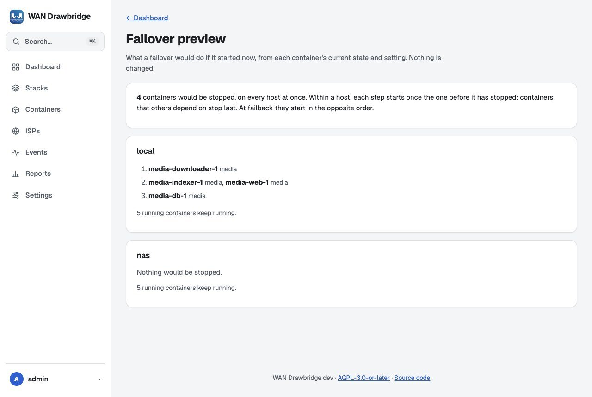

`/preview` (everyone) shows what a failover would do if it started now,
without changing anything. It lists every host and refreshes the inventory
first, as a sync does:

- The total number of containers that would be stopped.
- Per host, the stop order as numbered steps, one line per step, each
  container with its stack. Each step starts once the one before it has
  stopped; dependents come first and the containers others depend on last
  (see [Order of stopping and
  starting](stacks-and-containers.md#order-of-stopping-and-starting)). At
  failback they start in the opposite order.
- Containers set to stop that are already stopped: they would be left alone
  and not started at failback.
- How many running containers keep running.
- A host that cannot be reached, with the error: its containers would be
  stopped once it is back.

A banner says when a failover is already in effect (the containers it stopped
then show as already stopped), and how many new containers are not configured
yet and would keep running, with a link to review them.

### Timeline

A timeline of every check: green for the primary, amber for a backup, grey for
inconclusive checks and light grey for no data (Drawbridge not running, or a
gap longer than three check intervals). Hover a segment for the ISP and times.
**24 h**, **7 d** and **30 d** choose the window (24 hours by default; checks
are kept for the retention set in WAN detection, 30 days by default). A short
failover is a thin sliver at the longer scales.

### Latest changes

The last eight audit events, each as a sentence: the wording of its
[notification](notifications.md) where it has one ("Failed over to a backup
ISP"), else a short line such as "admin set the stack media to stop on
failover". A coloured dot marks failovers (amber), failbacks (green) and
failures (red). **All events** opens the Events page.

### New containers banner

"N new containers joined stacks with per-container settings and keep running
until you decide" appears when a stack you configured container by container
gets a new service. **Review them** opens the Containers page filtered to
them. See [new containers](stacks-and-containers.md#new-containers).

## Stacks

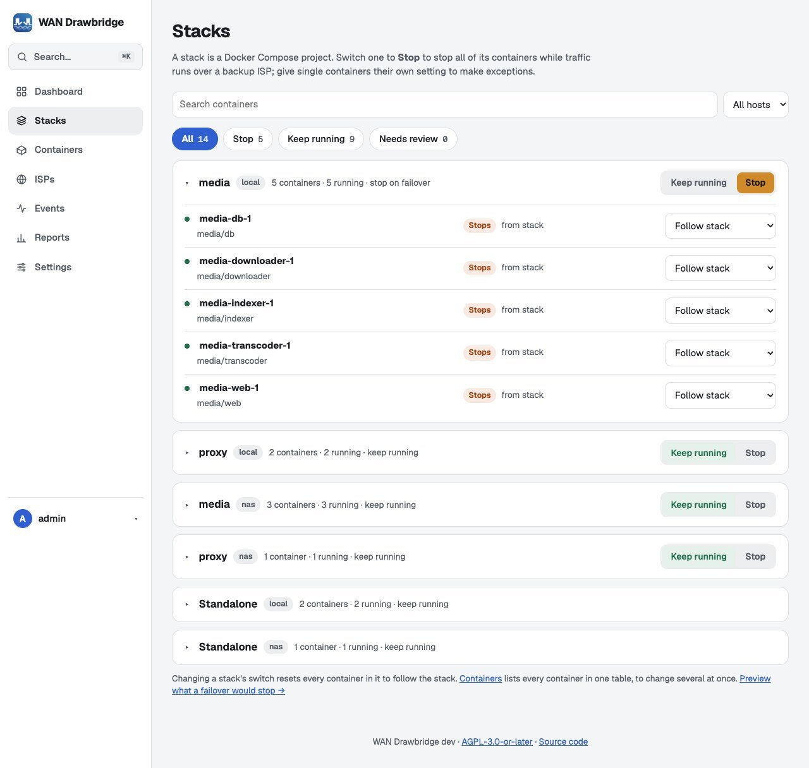

One card per Docker Compose project on each host, then one per host for its
**Standalone** containers. A card's line shows how many containers it has, how
many run, and what they do on failover: "keep running", "stop on failover", or
"split: 5 stop, 2 keep running", with a **Stops** or **Split** badge. "host
offline" (the card dimmed) means its host cannot be reached. With more than one
host, each card names its host.

A stack's line also holds its switch (admins): **Keep running** or **Stop**,
with **Split** between them while its containers differ. Choosing either
**resets every container in the stack** to follow it; from Split this asks for
confirmation.

Cards that stop or are split start open; click a card's line to open or close
it. An open card lists each container: its state dot, name and key, a **New**
badge while it [needs review](stacks-and-containers.md#new-containers), what it
does on failover and why ("from stack", "own setting", "default", "from label", or "until
reviewed"), and its setting (admins): *Follow stack* (*Default (keep
running)* when standalone), *Stop on failover* or *Keep running*. Choosing
*Keep running* in a stack that is switched to Stop asks for confirmation,
because it converts the stack rule into per-container settings.

**Filters** (the URL keeps them): a search by container name or key, the host
(with more than one host), and chips with counts: **All**, **Stop**, **Keep
running** and **Needs review**. While searching or filtering, only cards with a
matching container are shown, open, with only those containers.

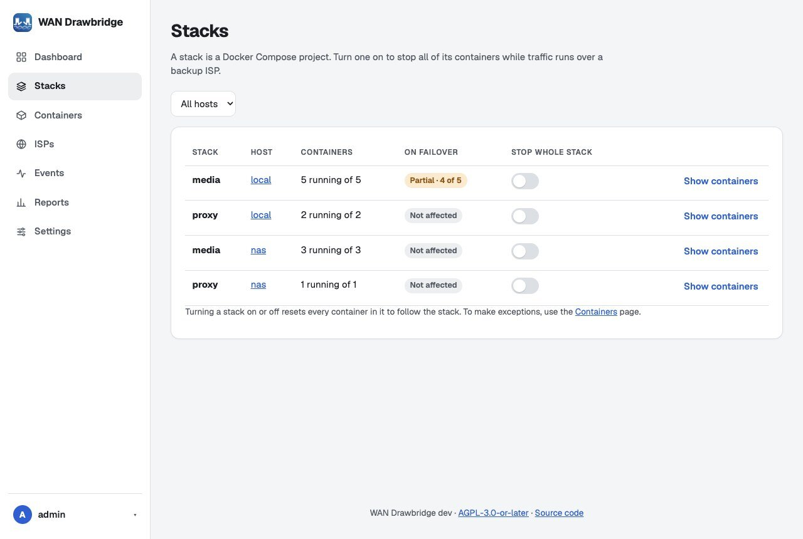

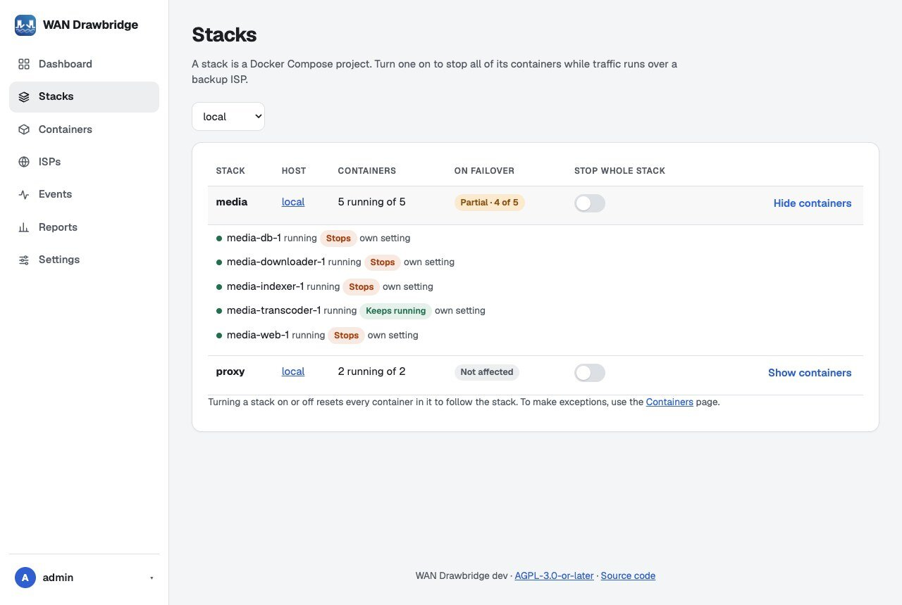

## Containers

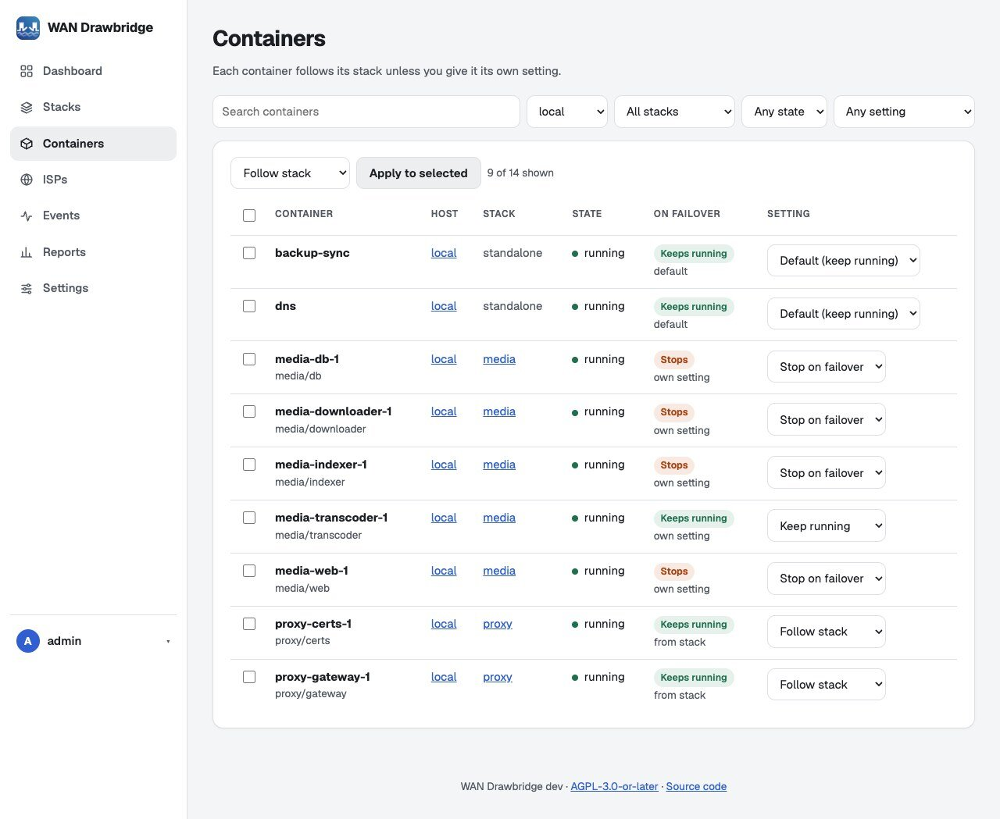

Every container on every host, except Drawbridge itself.

**Filters** (combine freely; the URL keeps them, so you can bookmark a view):

- Search by name or key.
- Host: all hosts or one. Shown only when Drawbridge has more than one host;
  the stack list then shows that host's stacks.
- Stack: all, standalone only, or one stack (on every host shown).
- State: running or stopped. "unknown" is shown when a host cannot be
  reached ("host offline", the row dimmed, when there is more than one
  host); then the list also includes its containers removed in the last 10
  minutes.
- Setting: stops on failover, keeps running, or "New, not configured".
- Show hidden: shown only when [container filters](#container-filters) are
  set. Containers matching one are left out unless this is ticked; then they
  are listed with a "hidden" badge. Above the table, "N hidden by container
  filters" counts the matching containers left out of the current view.

**Columns:** container name (with a "Swarm service" badge for a [service of a
swarm](hosts.md#adding-a-docker-swarm), "LXC" for a [Proxmox
container](hosts.md#adding-proxmox-ve-lxc-containers), the kind of a
[Kubernetes workload](hosts.md#adding-kubernetes), and its key,
`project/service`, when different),
host (only with more than one host; click it to filter by it), stack, state,
what happens on failover (with where that comes from: "from stack", "own
setting", "default", or "new, not configured", and in amber any warning its
host reports, such as an autoscaler that scales it back up), and the setting
(admins).

**Setting** for a container in a stack: *Follow stack*, *Stop on failover* or
*Keep running*. For a standalone container, *Default (keep running)* replaces
*Follow stack*.

Choosing *Keep running* for a container whose stack is switched on asks for
confirmation, because it converts the stack rule into per-container settings.
See [Choosing what to stop](stacks-and-containers.md#rule-2-overriding-one-container).

**Bulk edit:** tick containers (or the header box to select all shown), choose
a setting next to "Apply to selected", and apply.

## ISPs

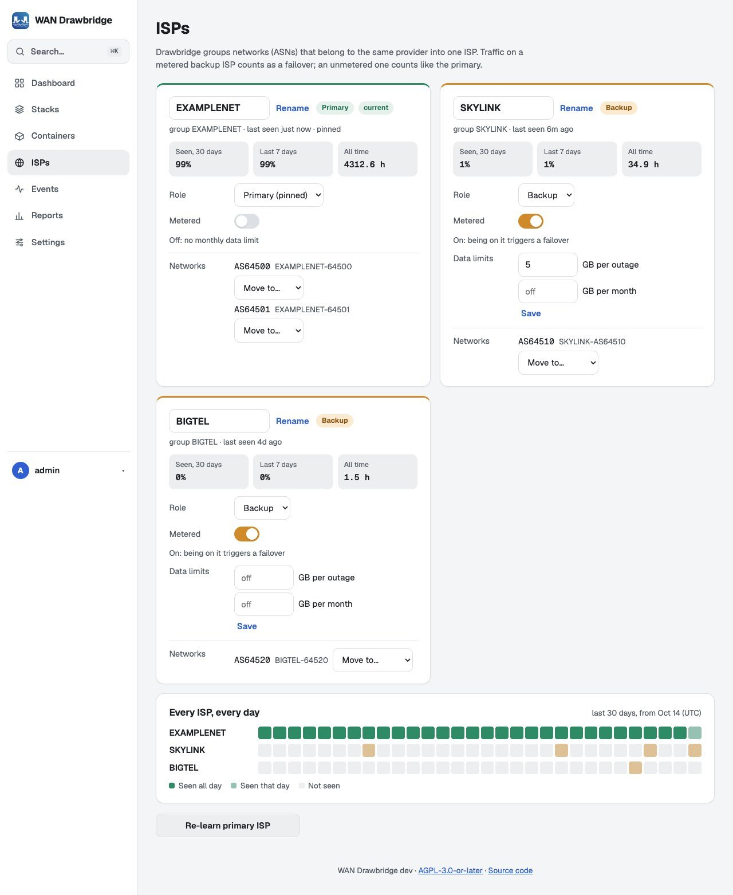

One card per ISP, the primary first:

| Part | Meaning |
| --- | --- |
| Name | Editable by admins (empty resets it), with its role badge (Primary, Backup or Ignored) and "current" while traffic is on it. Below: the group key, when it was last seen, and for the primary whether it is pinned or learned. |
| Seen, 30 days | Its share of the time observed in the last 30 days, excluding ignored ISPs. |
| Last 7 days | The same over the last 7 days. |
| All time | Hours observed. |
| Role | Primary (pinned when set by hand), Backup or Ignored (admins). |
| Metered | For the primary and backups: a switch (admins) with what it means. On a backup it is on for new ISPs, and off means traffic on it counts like the primary. On the primary it is a separate switch, off by default; on means its traffic counts towards its monthly data limit. See [Metered and unmetered ISPs](isps.md#metered-and-unmetered-isps). Viewers see yes or no; ignored ISPs show –. |
| Data limits | Only for a metered primary or backup: GB per outage (backups) and GB per month, with **Save** (admins). See [Data limits](isps.md#data-limits). Viewers see the limits, or "none". |
| Networks | Each ASN with its name, "grouped by hand" if moved, and a **Move to…** menu (admins). |

**Every ISP, every day** shows the last 30 days (UTC), one square per day and
ISP: solid when it was seen at least 95% of the day (of the day so far, for
today), lighter when seen for part of it, empty when not seen. Green for the
primary, amber for backups, grey for ignored ISPs. Hover a square for the time
seen that day.

**Re-learn primary ISP** forgets the primary and starts a new learning period.
See [ISPs and the primary ISP](isps.md).

## Events

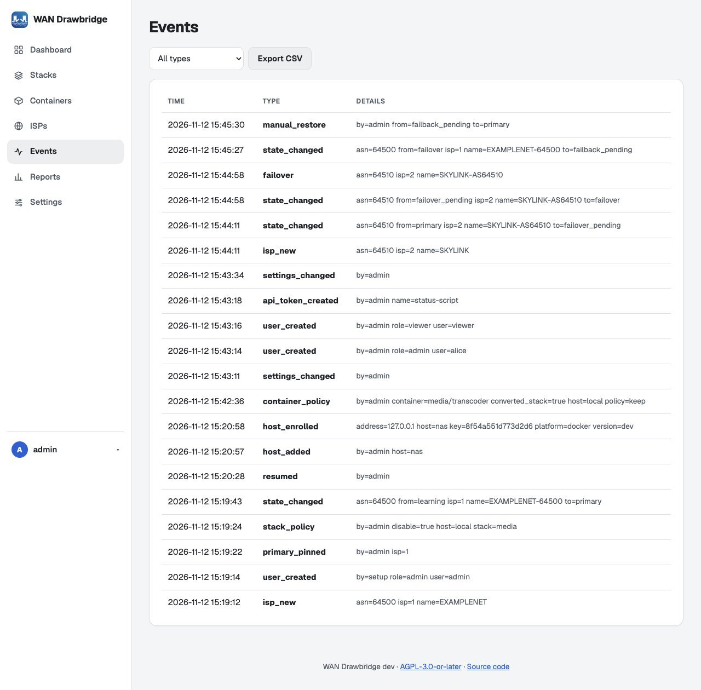

The audit log, newest first, 100 per page (**Older** for the next page). Filter
by type; **Export CSV** downloads up to 1,000 events of the selected type as
`drawbridge-events.csv`. The list of event types is in
[Monitoring → events](monitoring.md#event-types).

## Reports

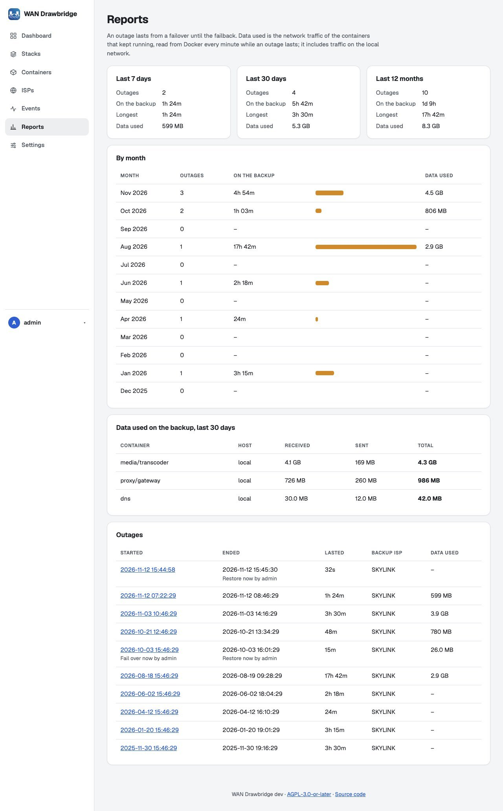

How often and how long Drawbridge failed over, and how much data the
containers used meanwhile. Everyone sees it. An **outage** lasts from a failover
(automatic, or **Fail over now**) until the failback (automatic, or **Restore
now**), including the failback pending wait. Failover tests are not outages.

- **Last 7 days, Last 30 days, Last 12 months:** the outages that lasted at
  some point in the period; **On the backup** counts only the part inside the
  period; **Longest** and **Data used** count those outages in full.
- **By month:** the last 12 calendar months in Drawbridge's time zone (`TZ`),
  newest first. An outage that crosses a month boundary counts in both months,
  with its time split between them; its data counts in the month it started.
  The bar compares each month's time on the backup with the busiest month's.
- **Data used on the backup, last 30 days:** the 10 containers that used the
  most, over the outages that lasted at some point in the last 30 days.
- **Outages:** newest first, 50 per page (**Older** for the next page), with
  start, end (or *ongoing*), how long it lasted, the backup ISP and the data
  used. Who used **Fail over now** or **Restore now** is shown under the time.
  Click a start time for the outage's page, `/reports/outages/{id}`, with the
  data used by each container.

With more than one host, both container tables have a **Host** column: the
same container key on two hosts is counted separately.

### How data is measured

While an outage lasts, Drawbridge reads Docker's network counters (bytes
received and sent) of every running container once a minute, and adds the
difference since the previous reading:

- The first reading of a container in an outage only sets the starting
  point, so traffic in the minute before it (and from a container created
  during the outage until its first reading) is not counted; neither is the
  traffic after the last reading before the failback, up to a minute.
- A container that restarts or is re-created starts its counters at zero;
  Drawbridge notices (lower counters, or a new container ID) and counts the new
  counters in full.
- The counters include all of a container's traffic: the internet, but also
  your local network and other containers. They are an upper bound for what
  went over the backup line.
- Containers on the host network (`network_mode: host`) have no counters and
  are not listed. Containers on another container's network
  (`network_mode: service:...`) show no traffic of their own: it is counted
  under the container whose network they share.
- Outages from before this version have no data; their times come from the
  event log.

**Received** is what the container downloaded, **Sent** what it uploaded;
sizes are in decimal units (1 MB = 1,000,000 bytes).

## Settings

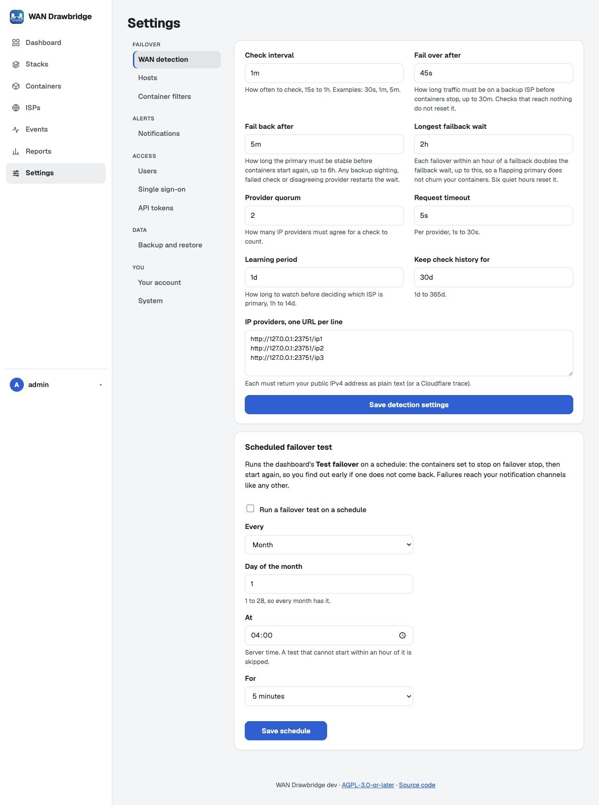

Settings has one tab per section, each at its own address, so a tab can be
bookmarked. `/settings` opens the first one. The tabs are a menu down the left,
grouped under **Failover**, **Alerts**, **Access**, **Data** and **You**; on a
narrow screen they become one row that scrolls sideways.

| Group | Tab | Address | Who | Contents |
| --- | --- | --- | --- | --- |
| Failover | WAN detection | `/settings/detection` | everyone | The detection settings described in the [setup wizard](setup-wizard.md#4-wan-detection), and the [scheduled failover test](during-an-outage.md#scheduled-tests). Viewers see them read-only. Changes apply from the next check. |
| Failover | Hosts | `/settings/hosts` | everyone | The local host and the agent hosts, with their status, version and key (Swarm, Proxmox VE and Kubernetes hosts marked **experimental**, as they are [not yet tested on real equipment](hosts.md#tested-so-far)); admins add hosts, rotate keys, revoke, disable, rename and remove them. See [Hosts and agents](hosts.md). Viewers see the list read-only, without the manager key. |
| Failover | Container filters | `/settings/container-filters` | everyone | Patterns of containers the Containers page hides; see [Container filters](#container-filters). Viewers see them read-only. |
| Alerts | Notifications | `/settings/notifications` | admins | Channels that get events; see [Notifications](notifications.md). |
| Access | Users | `/settings/users` | admins | Accounts; see [Users](#users). |
| Access | Single sign-on | `/settings/sso` | admins | See [Single sign-on](single-sign-on.md). |
| Access | API tokens | `/settings/api` | admins | Make and revoke tokens for the JSON status API; see [Monitoring → JSON status API](monitoring.md#json-status-api). |
| Data | Backup and restore | `/settings/backup` | admins | Download an encrypted backup file, with history of the last 30, 60 or 90 days, all time, or none; schedule daily backups into a folder; restore one. See [Backup and restore](backup-and-restore.md#backup-files). |
| You | Your account | `/settings/account` | everyone | Link or unlink your single sign-on account; change your password (this signs you out everywhere, including this browser); [two-factor sign-in](#two-factor-sign-in); your profile picture (see [Profile pictures](#profile-pictures)); your colour theme and mode (see [Appearance](#appearance)). |
| You | System | `/settings/system` | everyone | Drawbridge version, Docker connection and version, database path and size. |

Viewers do not see the admin tabs; opening one's address gives 403.

### Container filters

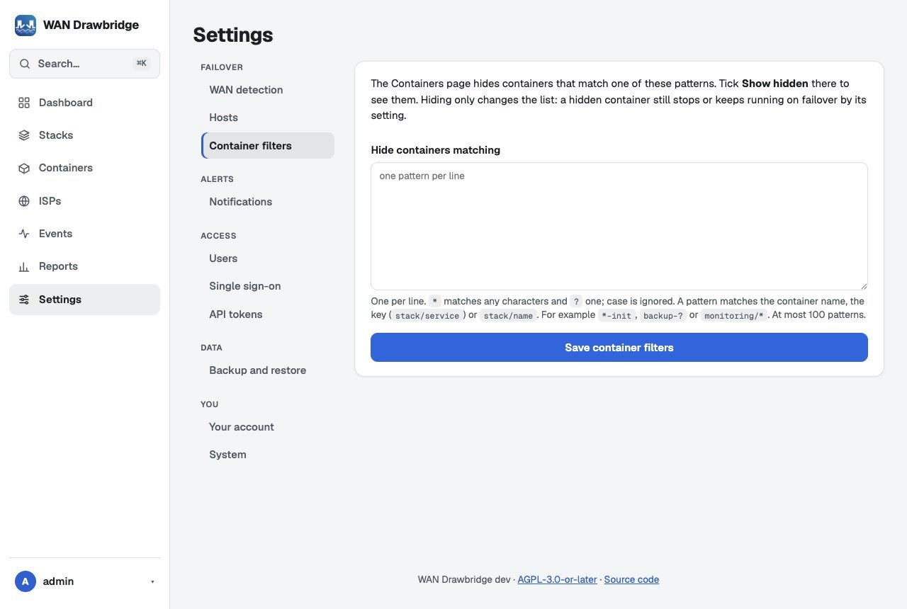

**Settings → Container filters** hides containers you don't want to see on
the Containers page, such as one-off init or backup containers. Admins enter
one pattern per line and click **Save container filters**:

- `*` matches any run of characters (also none), `?` exactly one character.
  Case is ignored, and the pattern must match the whole text.
- A pattern is tried against the container name, its key
  (`project/service` for a Compose container) and `stack/name`. For example
  `*-init`, `backup-?` or `monitoring/*`.
- Blank lines and repeats (ignoring case) are dropped. At most 100 patterns
  of at most 200 characters each; more gives an error and nothing is saved.
- The filters apply to every user and every host, and are part of the
  configuration in a [backup](backup-and-restore.md#what-is-in-it).

Hiding only changes the Containers list. A hidden container still stops or
keeps running on failover by its setting, and the Stacks page, the dashboard
and the reports still show it. Saving records a `settings_changed` event.

### Users

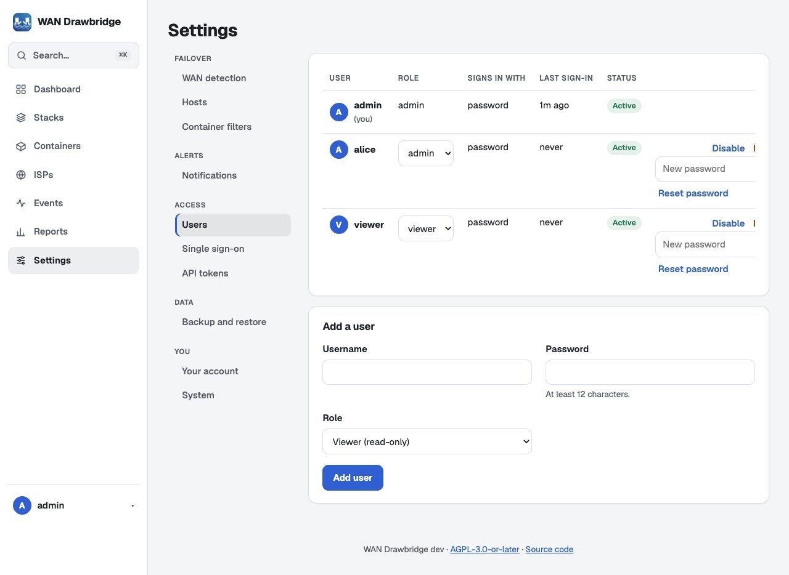

**Settings → Users** (admins) lists every account with its role, how it signs in (password, "password +
code" with two-factor sign-in, single sign-on, or both), last sign-in and
status. For other users you can change the **Role**
(viewer or admin; not for accounts without a password while an SSO admin group
is set, since the group decides theirs), **Disable** (signs them out
everywhere), **Enable**, **Delete** (also removes their sessions and
single sign-on links; it asks first and cannot be undone) and **Reset
password**. Reset password is shown only for accounts that have a password, not
for ones that sign in with single sign-on only. **Turn off 2FA** appears for
accounts with two-factor sign-in, for someone who lost their phone and their
recovery codes. **Add a user** creates a viewer or admin with a password.

Safety rules:

- You cannot disable, delete or change the role of yourself.
- The last enabled admin cannot be disabled, deleted or turned into a viewer.

Usernames are case-insensitive: `Alice` and `alice` are the same account.

### Two-factor sign-in

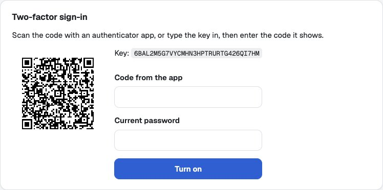

Accounts that sign in with a password can also require a code from an
authenticator app (any app for time-based one-time passwords: 2FAS, Aegis,
Google Authenticator, 1Password, Bitwarden and others). It is offered only
when the account has a password, password sign-in is allowed, and the account
is **not** linked to single sign-on: a linked account should use the
provider's own two-factor sign-in. Linking single sign-on turns it off.

To turn it on, in **Settings → Your account → Two-factor sign-in**:

1. Click **Set up**. Scan the QR code with the app, or type the key in.
2. Enter the code the app shows and your current password, then **Turn on**.
3. Save the 10 **recovery codes** shown, somewhere other than your phone.
   They are shown once. Each works once instead of an app code.

From then on, signing in with your password opens a second step, **Two-factor
sign-in**, which asks for a code:

- The code has 6 digits and changes every 30 seconds. The code before and the
  code after the current one are also accepted, for a clock that is slightly
  off. A code that was used (or an older one) is refused, so a code cannot be
  replayed.
- A recovery code works too (`k3f9-x2pq-7hwd`; with or without dashes, in any
  case). Using one records a `recovery_code_used` event with how many are left.
- The second step lasts 5 minutes and allows 5 tries; then sign in again.
  Wrong codes count toward the [sign-in rate limit](../technical/security.md#sign-in-rate-limit).
- Single sign-on is not affected.

While it is on, the card shows how many recovery codes are left, with **New
recovery codes** (replaces all of them) and **Turn off**, both after your
current password.

Lost your phone and your recovery codes? Another admin can click **Turn off
2FA** for you in Settings → Users. If you are the only admin, run
`docker compose exec drawbridge /drawbridge reset-2fa <user>` (see the
[command line](cli.md#reset-2fa)).

## Appearance

### Profile pictures

**Settings → Your account → Profile picture** uploads a PNG, JPEG, GIF or WebP
image of up to 1 MB (other types, SVG included, are refused). It shows in the
top-right menu and, for admins, in Settings → Users. **Remove picture** deletes
the current picture, uploaded or from single sign-on.

Accounts linked to single sign-on also get the picture from the provider's
`picture` claim at each SSO sign-in (see
[Single sign-on](single-sign-on.md#profile-pictures)). An uploaded picture
always wins; remove it to go back to the provider's. Removing the provider's
picture keeps it away: later SSO sign-ins no longer set one, until you click
**Use it again** (it then returns at your next SSO sign-in). Without any
picture, the first letter of the username is shown instead.

Pictures are not in backup files; see
[Backup and restore](backup-and-restore.md#backup-files).

**Settings → Your account → Appearance** sets the colours for your account only. It applies
on every device you sign in on, and changes show at once.

- **Theme**: Drawbridge (the default), Nord, Solarized, Gruvbox, Catppuccin or
  Tokyo Night. Each has a light and a dark version; the cards show both.
- **Mode**: **Automatic** (the default) follows your device's light or dark
  setting; **Light** and **Dark** fix it.

Every theme keeps text, links, buttons and status colours at a contrast of at
least 4.5:1 (body text 7:1) in both versions. The sign-in page, before anyone is
signed in, uses the default theme in automatic mode. Themes need a browser from
2024 or later (Chrome and Edge 123, Firefox 120, Safari 17.5).

## Phone and dark mode

| Phone | Dark mode |
| --- | --- |
| 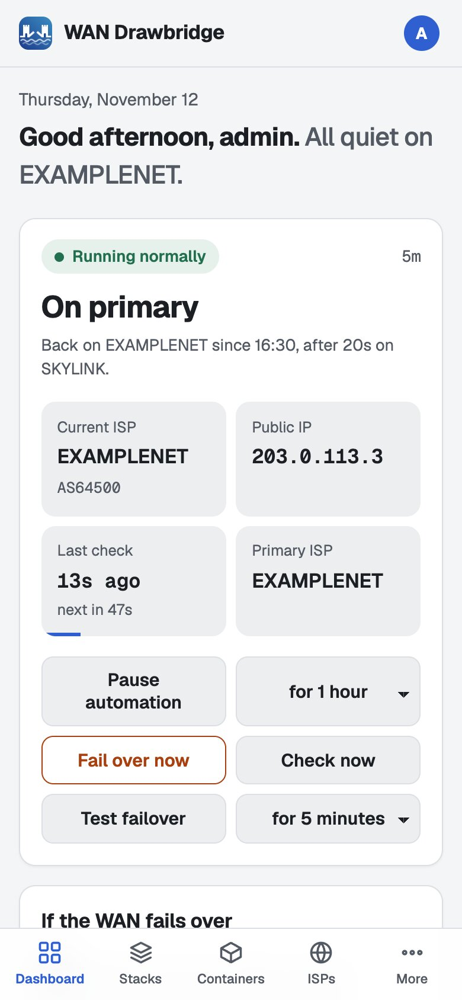 | 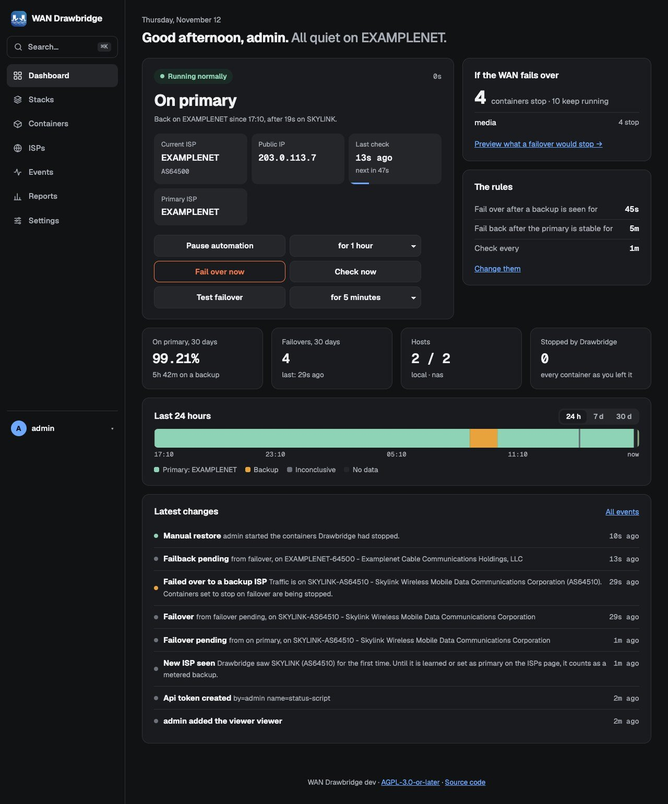 |
| 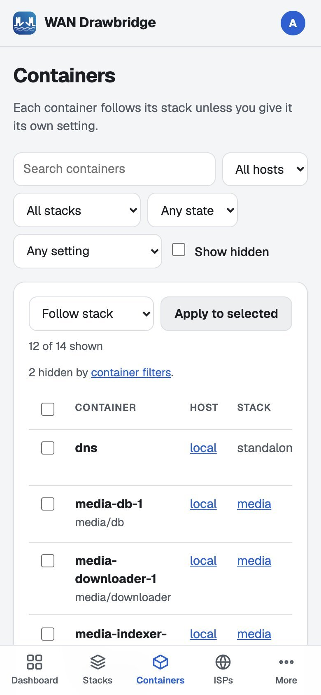 | 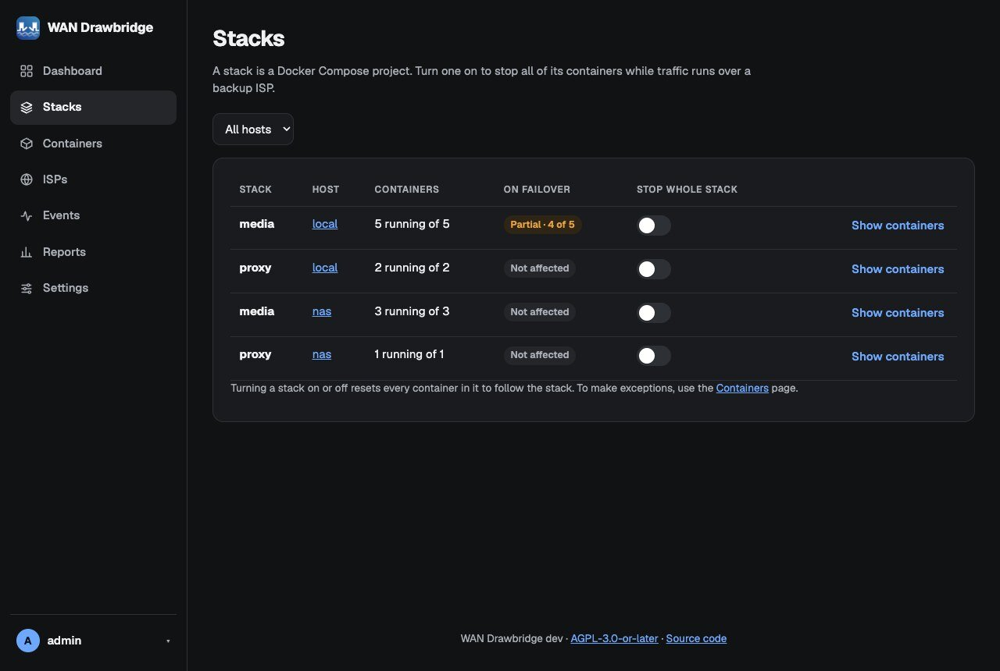 |

## Notes

- Over plain HTTP, browsers allow only about six open connections to one host.
  Each open Drawbridge tab keeps one for live updates, so with many tabs open
  pages can stall. Serving Drawbridge over HTTPS (through a reverse proxy)
  lifts this limit.
- Toast messages at the bottom confirm saves and show errors.
