# Using the web UI

The web UI is a set of server-rendered pages that update themselves live: when
the WAN state changes or a container starts or stops, open pages refresh the
affected part within a second, without reloading. It works on phones (the
navigation bar and the Settings tabs scroll sideways) and follows your system's light or dark mode,
in the colour theme you choose (see [Appearance](#appearance)).

Your picture and username sit at the top right. Click them for a menu with
**Your account** (Settings → Your account) and **Sign out**; a click elsewhere
or Escape closes it. On a phone only the picture is shown.

There are two roles:

- **Admins** can change everything.
- **Viewers** see every page, but in Settings only the **WAN detection**
  (read-only), **Your account** and **System** tabs. They can change only their
  own password, single sign-on link and appearance. Controls they cannot use
  are not shown.

Every page footer shows the version and links to the source code, as the AGPL
requires, and credits the app icon (Drawbridge icons created by Magnific -
Flaticon).

## Dashboard

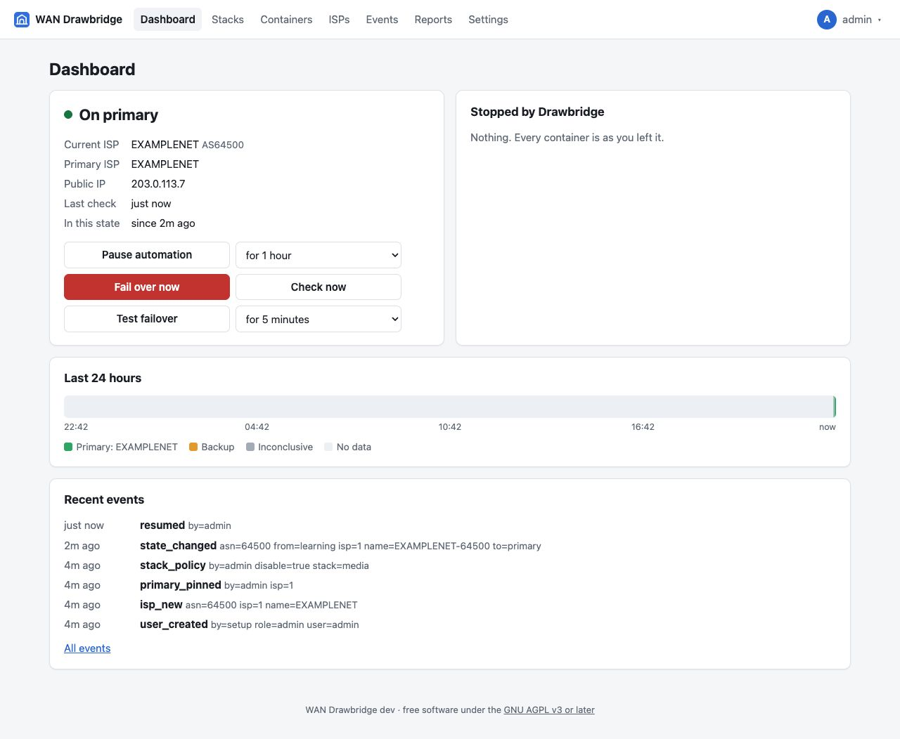

### Status card

The coloured dot and label show the state:

| Label | Colour | Meaning |
| --- | --- | --- |
| Learning | grey | No primary ISP is known yet. Nothing is stopped. |
| On primary | green | Traffic leaves through the primary ISP. |
| Failover pending | amber | Traffic is on a backup ISP; Drawbridge is confirming it. Shows "failing over in 32s unless the primary returns". |
| Failover | red | Confirmed on a backup. Selected containers are stopped. |
| Failback pending | amber | The primary is back; Drawbridge is making sure it stays. Shows "failing back in 4m 56s if the primary stays stable". |

Badges next to the label:

- **Paused**: automation is paused; states still change but no container is
  touched.
- **stopping containers / starting containers / applying containers**: a
  container run is in progress.

If the primary ISP has been flapping, a banner explains how long failback now
waits (see [flapping](during-an-outage.md#flapping)).

The facts below the label:

| Fact | Meaning |
| --- | --- |
| Current ISP | The ISP of the last conclusive check, with the ASN that announced the IP. |
| Primary ISP | The primary, or "Not known yet" with a link to the ISPs page. |
| Public IP | The IPv4 address the providers agreed on. |
| Last check | How long ago; "· inconclusive" if the last check could not determine the IP. |
| In this state | How long the current state has lasted. |

### Buttons (admins)

The buttons sit in two equal columns: Pause automation and how long on the
first row (Resume automation fills the row while paused), then Fail over now,
Restore now or End test now beside Check now, then Test failover and how long.

| Button | When shown | What it does |
| --- | --- | --- |
| Pause automation / Resume automation | Always | Pausing keeps checking but stops all container actions, for the time chosen next to the button (30 minutes to 24 hours, default 1 hour) or until resumed. Resuming brings containers in line with the current state at once: stopped if in Failover, started again if on the primary. |
| Check now | Always | Runs a check immediately instead of waiting for the next one. |
| Fail over now | When nothing is stopped | After a confirmation, stops every container set to stop, as if a backup ISP had been confirmed. |
| Test failover | On the primary or learning, when nothing is stopped | After a confirmation, stops every container set to stop for 2 to 15 minutes, then starts them again; the WAN state does not change. See [Manual controls](during-an-outage.md#manual-controls). |
| End test now | During a failover test | Starts the containers the test stopped. |
| Restore now | While Drawbridge holds stopped containers, or the state is Failover or Failback pending | After a confirmation, starts what Drawbridge stopped and returns to the primary state. If traffic is still on a backup, the normal failover checks run again. |

See [manual controls](during-an-outage.md#manual-controls) for the details.

### Stopped by Drawbridge

Lists every container in the current failover run and what happened to it:

| Entry | Meaning |
| --- | --- |
| stopped | Drawbridge stopped it and will start it at failback. |
| started again | Started during this failover (its setting changed). |
| was already stopped; left alone | It was not running when the failover began, so it will not be started at failback. |
| waiting | Not processed yet. |
| *error text* in red | Stopping or starting it failed; the Docker error is shown. |

With more than one host, each entry also names its host ("media-db-1 on
nas"). "N containers on *host* will be started again once Drawbridge can
reach it" lists starts owed to a host that could not be reached at the
failback; Drawbridge tries again every minute (see [hosts that cannot be
reached](during-an-outage.md#hosts-that-cannot-be-reached)).

"Nothing. Every container is as you left it." means there is no open run and
no start is owed.

### Last 24 hours

A timeline of every check: green for the primary, amber for a backup, grey for
inconclusive checks and light grey for no data (Drawbridge not running, or a
gap longer than three check intervals). Hover a segment for the ISP and times.
A short failover is a thin sliver at this scale.

### Recent events

The last few audit events. **All events** opens the Events page.

### New containers banner

"N new containers joined stacks with per-container settings and keep running
until you decide" appears when a stack you configured container by container
gets a new service. **Review them** opens the Containers page filtered to
them. See [new containers](stacks-and-containers.md#new-containers).

## Stacks

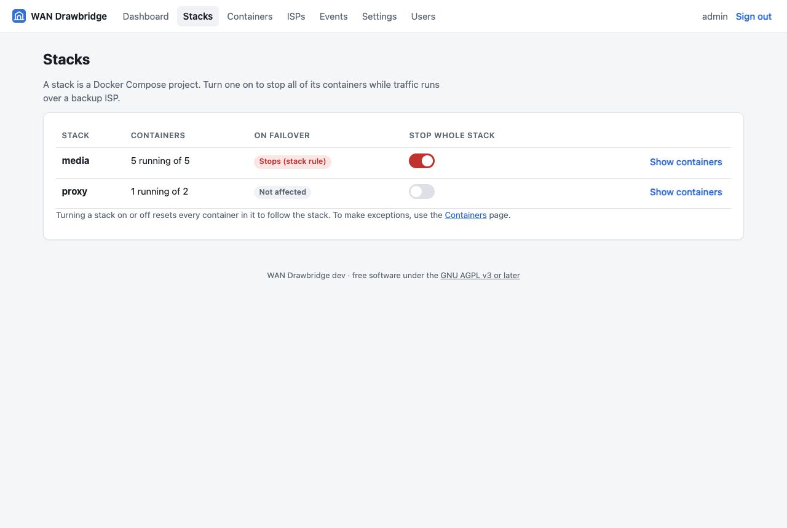

One row per Docker Compose project on each host:

| Column | Meaning |
| --- | --- |
| Stack | The Compose project name. |
| Host | The host it is on. Shown only when Drawbridge has more than one host; click it to show that host's stacks only. |
| Containers | "3 running of 5", or "host offline" (the row dimmed) when its host cannot be reached. |
| On failover | **Stops (stack rule)**: the stack switch is on. **Partial · 4 of 5**: some containers stop through their own settings. **Not affected**: nothing in it stops. |
| Stop whole stack | The switch (admins). |
| Show containers | Expands the stack's containers with their state and whether each stops; it then reads Hide containers, which collapses them again. |

Flipping the switch **resets every container in the stack** to follow it, on or
off. Exceptions are made on the Containers page.

With more than one host, a **host filter** above the table shows all hosts or
one; the URL keeps it (`/stacks?host=<id>`). The same project on two hosts is
two rows with their own switches.

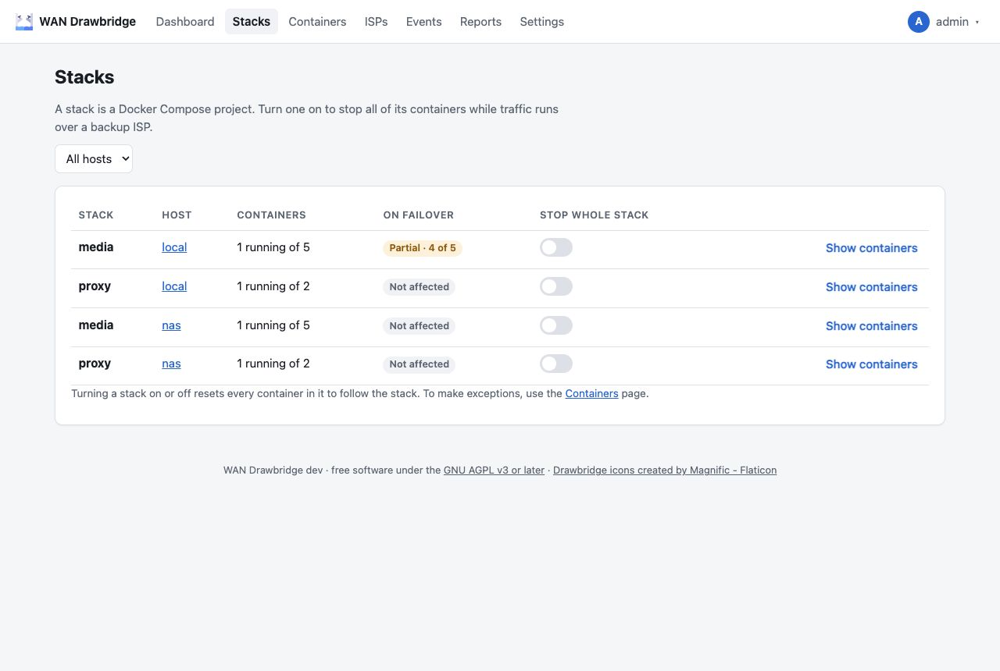

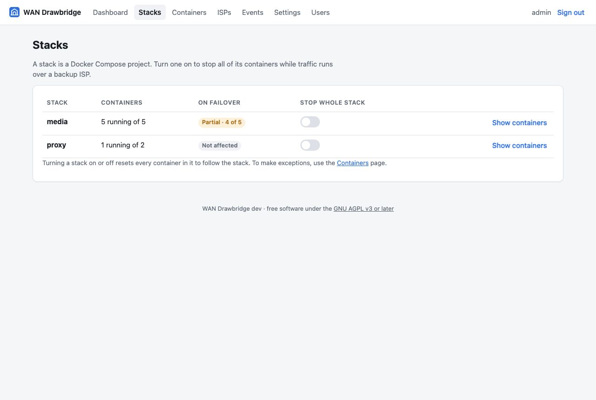

## Containers

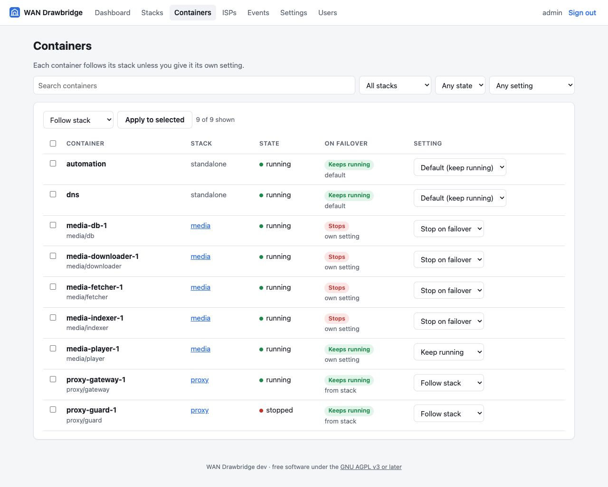

Every container on every host, except Drawbridge itself.

**Filters** (combine freely; the URL keeps them, so you can bookmark a view):

- Search by name or key.
- Host: all hosts or one. Shown only when Drawbridge has more than one host;
  the stack list then shows that host's stacks.
- Stack: all, standalone only, or one stack (on every host shown).
- State: running or stopped. "unknown" is shown when a host cannot be
  reached ("host offline", the row dimmed, when there is more than one
  host); then the list also includes its containers removed in the last 10
  minutes.
- Setting: stops on failover, keeps running, or "New, not configured".
- Show hidden: shown only when [container filters](#container-filters) are
  set. Containers matching one are left out unless this is ticked; then they
  are listed with a "hidden" badge. Above the table, "N hidden by container
  filters" counts the matching containers left out of the current view.

**Columns:** container name (with a "Swarm service" badge for a [service of a
swarm](hosts.md#adding-a-docker-swarm), "LXC" for a [Proxmox
container](hosts.md#adding-proxmox-ve-lxc-containers), the kind of a
[Kubernetes workload](hosts.md#adding-kubernetes), and its key,
`project/service`, when different),
host (only with more than one host; click it to filter by it), stack, state,
what happens on failover (with where that comes from: "from stack", "own
setting", "default", or "new, not configured", and in amber any warning its
host reports, such as an autoscaler that scales it back up), and the setting
(admins).

**Setting** for a container in a stack: *Follow stack*, *Stop on failover* or
*Keep running*. For a standalone container, *Default (keep running)* replaces
*Follow stack*.

Choosing *Keep running* for a container whose stack is switched on asks for
confirmation, because it converts the stack rule into per-container settings.
See [Choosing what to stop](stacks-and-containers.md#rule-2-overriding-one-container).

**Bulk edit:** tick containers (or the header box to select all shown), choose
a setting next to "Apply to selected", and apply.

## ISPs

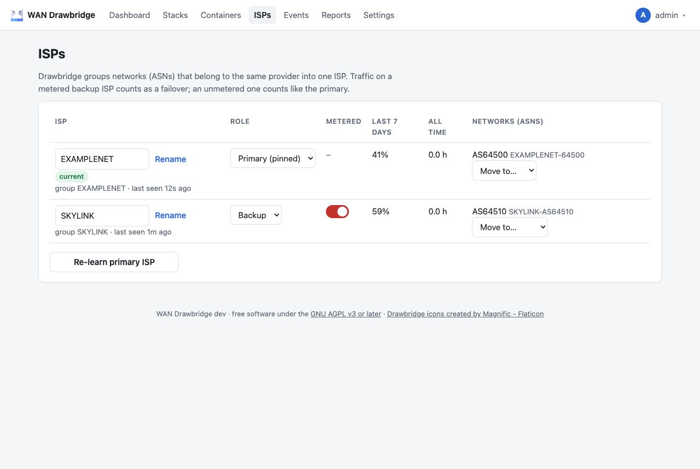

One row per ISP:

| Column | Meaning |
| --- | --- |
| ISP | Name (editable by admins; empty resets it), "current" badge, group key and when last seen. |
| Role | Primary (pinned or "learned"), Backup or Ignored. |
| Metered | For backups: a switch (admins), on for new ISPs. Off means traffic on it counts like the primary; see [Metered and unmetered backups](isps.md#metered-and-unmetered-backups). Viewers see yes or no; the primary and ignored ISPs show –. |
| Last 7 days | Share of observed time, excluding ignored ISPs. |
| All time | Hours observed. |
| Networks (ASNs) | Each ASN with its name, "grouped by hand" if moved, and a **Move to…** menu. |

**Re-learn primary ISP** forgets the primary and starts a new learning period.
See [ISPs and the primary ISP](isps.md).

## Events

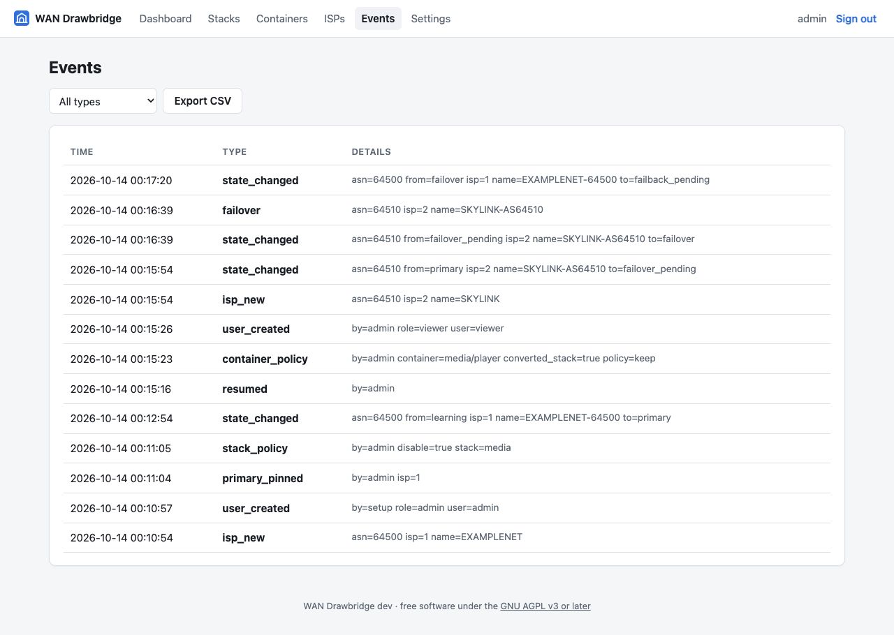

The audit log, newest first, 100 per page (**Older** for the next page). Filter
by type; **Export CSV** downloads up to 1,000 events of the selected type as
`drawbridge-events.csv`. The list of event types is in
[Monitoring → events](monitoring.md#event-types).

## Reports

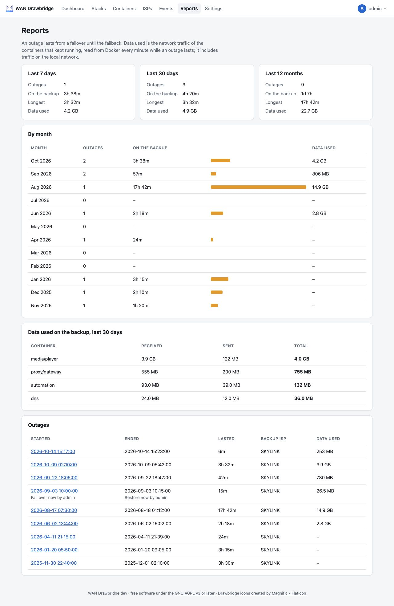

How often and how long Drawbridge failed over, and how much data the
containers used meanwhile. Everyone sees it. An **outage** lasts from a failover
(automatic, or **Fail over now**) until the failback (automatic, or **Restore
now**), including the failback pending wait. Failover tests are not outages.

- **Last 7 days, Last 30 days, Last 12 months:** the outages that lasted at
  some point in the period; **On the backup** counts only the part inside the
  period; **Longest** and **Data used** count those outages in full.
- **By month:** the last 12 calendar months in Drawbridge's time zone (`TZ`),
  newest first. An outage that crosses a month boundary counts in both months,
  with its time split between them; its data counts in the month it started.
  The bar compares each month's time on the backup with the busiest month's.
- **Data used on the backup, last 30 days:** the 10 containers that used the
  most, over the outages that lasted at some point in the last 30 days.
- **Outages:** newest first, 50 per page (**Older** for the next page), with
  start, end (or *ongoing*), how long it lasted, the backup ISP and the data
  used. Who used **Fail over now** or **Restore now** is shown under the time.
  Click a start time for the outage's page, `/reports/outages/{id}`, with the
  data used by each container.

With more than one host, both container tables have a **Host** column: the
same container key on two hosts is counted separately.

### How data is measured

While an outage lasts, Drawbridge reads Docker's network counters (bytes
received and sent) of every running container once a minute, and adds the
difference since the previous reading:

- The first reading of a container in an outage only sets the starting
  point, so traffic in the minute before it (and from a container created
  during the outage until its first reading) is not counted; neither is the
  traffic after the last reading before the failback, up to a minute.
- A container that restarts or is re-created starts its counters at zero;
  Drawbridge notices (lower counters, or a new container ID) and counts the new
  counters in full.
- The counters include all of a container's traffic: the internet, but also
  your local network and other containers. They are an upper bound for what
  went over the backup line.
- Containers on the host network (`network_mode: host`) have no counters and
  are not listed. Containers on another container's network
  (`network_mode: service:...`) show no traffic of their own: it is counted
  under the container whose network they share.
- Outages from before this version have no data; their times come from the
  event log.

**Received** is what the container downloaded, **Sent** what it uploaded;
sizes are in decimal units (1 MB = 1,000,000 bytes).

## Settings

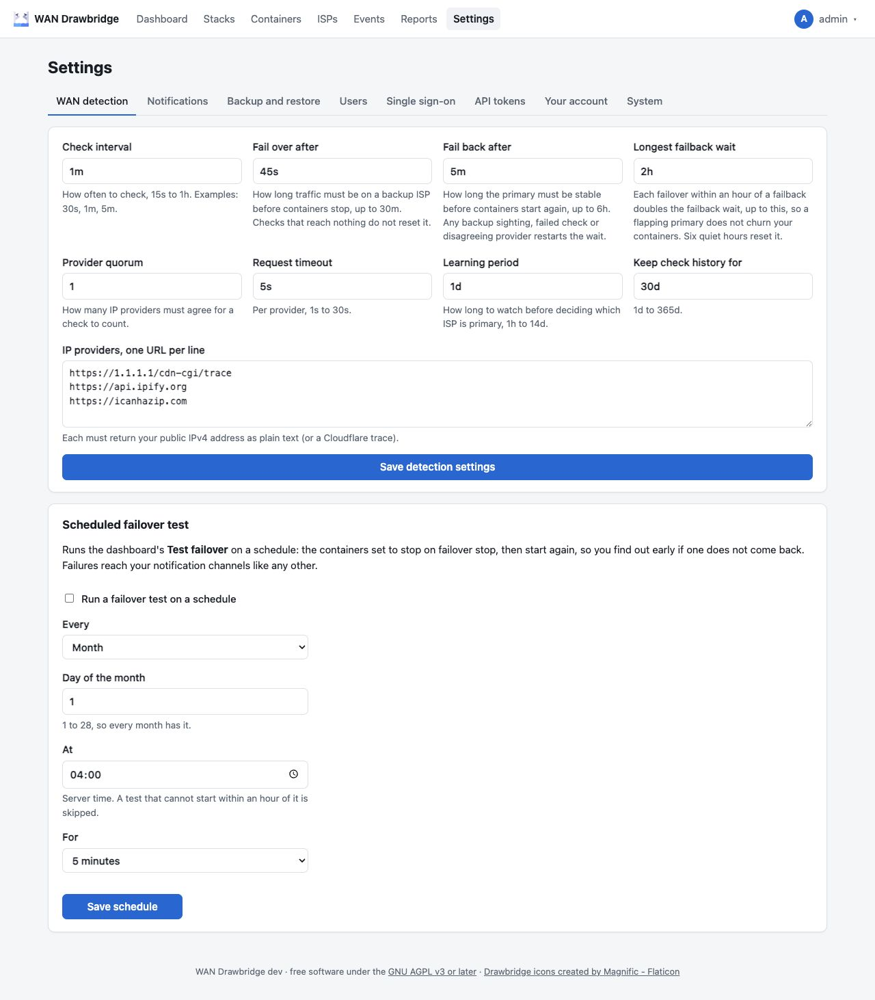

Settings has one tab per section, each at its own address, so a tab can be
bookmarked. `/settings` opens the first one.

| Tab | Address | Who | Contents |
| --- | --- | --- | --- |
| WAN detection | `/settings/detection` | everyone | The detection settings described in the [setup wizard](setup-wizard.md#4-wan-detection), and the [scheduled failover test](during-an-outage.md#scheduled-tests). Viewers see them read-only. Changes apply from the next check. |
| Notifications | `/settings/notifications` | admins | Channels that get events; see [Notifications](notifications.md). |
| Backup and restore | `/settings/backup` | admins | Download an encrypted backup file, with history of the last 30, 60 or 90 days, all time, or none; schedule daily backups into a folder; restore one. See [Backup and restore](backup-and-restore.md#backup-files). |
| Users | `/settings/users` | admins | Accounts; see [Users](#users). |
| Single sign-on | `/settings/sso` | admins | See [Single sign-on](single-sign-on.md). |
| API tokens | `/settings/api` | admins | Make and revoke tokens for the JSON status API; see [Monitoring → JSON status API](monitoring.md#json-status-api). |
| Container filters | `/settings/container-filters` | everyone | Patterns of containers the Containers page hides; see [Container filters](#container-filters). Viewers see them read-only. |
| Hosts | `/settings/hosts` | everyone | The local host and the agent hosts, with their status, version and key (Swarm, Proxmox VE and Kubernetes hosts marked **experimental**, as they are [not yet tested on real equipment](hosts.md#tested-so-far)); admins add hosts, rotate keys, revoke, disable, rename and remove them. See [Hosts and agents](hosts.md). Viewers see the list read-only, without the manager key. |
| Your account | `/settings/account` | everyone | Link or unlink your single sign-on account; change your password (this signs you out everywhere, including this browser); [two-factor sign-in](#two-factor-sign-in); your profile picture (see [Profile pictures](#profile-pictures)); your colour theme and mode (see [Appearance](#appearance)). |
| System | `/settings/system` | everyone | Drawbridge version, Docker connection and version, database path and size. |

Viewers do not see the admin tabs; opening one's address gives 403.

### Container filters

**Settings → Container filters** hides containers you don't want to see on
the Containers page, such as one-off init or backup containers. Admins enter
one pattern per line and click **Save container filters**:

- `*` matches any run of characters (also none), `?` exactly one character.
  Case is ignored, and the pattern must match the whole text.
- A pattern is tried against the container name, its key
  (`project/service` for a Compose container) and `stack/name`. For example
  `*-init`, `backup-?` or `monitoring/*`.
- Blank lines and repeats (ignoring case) are dropped. At most 100 patterns
  of at most 200 characters each; more gives an error and nothing is saved.
- The filters apply to every user and every host, and are part of the
  configuration in a [backup](backup-and-restore.md#what-is-in-it).

Hiding only changes the Containers list. A hidden container still stops or
keeps running on failover by its setting, and the Stacks page, the dashboard
and the reports still show it. Saving records a `settings_changed` event.

### Users

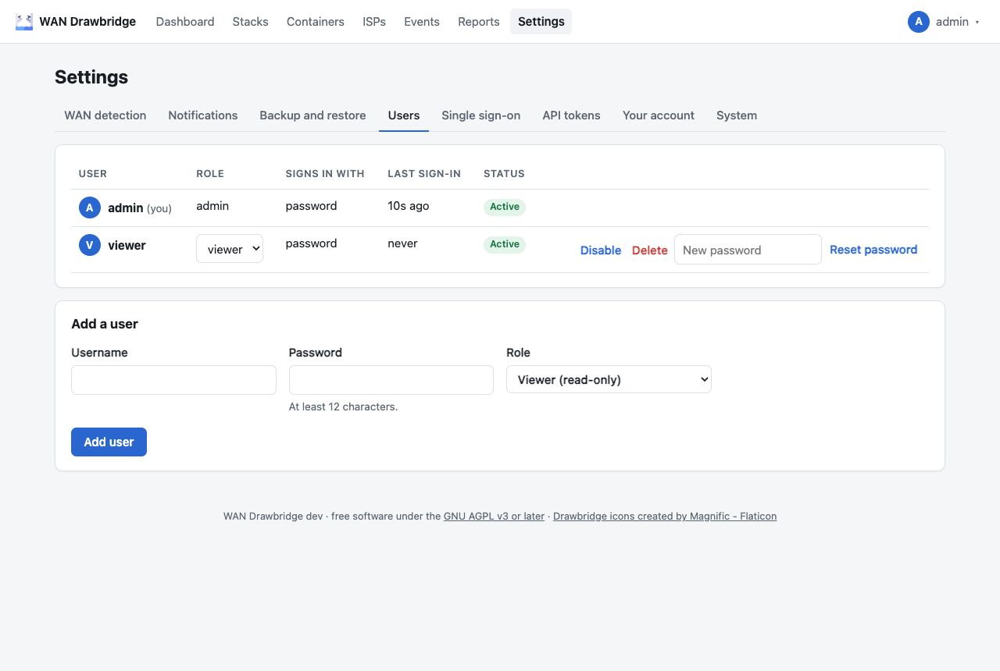

**Settings → Users** (admins) lists every account with its role, how it signs in (password, "password +
code" with two-factor sign-in, single sign-on, or both), last sign-in and
status. For other users you can change the **Role**
(viewer or admin; not for accounts without a password while an SSO admin group
is set, since the group decides theirs), **Disable** (signs them out
everywhere), **Enable**, **Delete** (also removes their sessions and
single sign-on links; it asks first and cannot be undone) and **Reset
password**. Reset password is shown only for accounts that have a password, not
for ones that sign in with single sign-on only. **Turn off 2FA** appears for
accounts with two-factor sign-in, for someone who lost their phone and their
recovery codes. **Add a user** creates a viewer or admin with a password.

Safety rules:

- You cannot disable, delete or change the role of yourself.
- The last enabled admin cannot be disabled, deleted or turned into a viewer.

Usernames are case-insensitive: `Alice` and `alice` are the same account.

### Two-factor sign-in

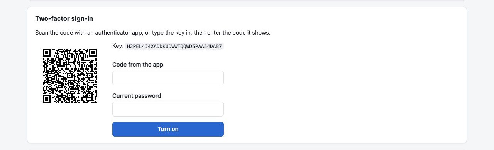

Accounts that sign in with a password can also require a code from an
authenticator app (any app for time-based one-time passwords: 2FAS, Aegis,
Google Authenticator, 1Password, Bitwarden and others). It is offered only
when the account has a password, password sign-in is allowed, and the account
is **not** linked to single sign-on: a linked account should use the
provider's own two-factor sign-in. Linking single sign-on turns it off.

To turn it on, in **Settings → Your account → Two-factor sign-in**:

1. Click **Set up**. Scan the QR code with the app, or type the key in.
2. Enter the code the app shows and your current password, then **Turn on**.
3. Save the 10 **recovery codes** shown, somewhere other than your phone.
   They are shown once. Each works once instead of an app code.

From then on, signing in with your password opens a second step, **Code from
your authenticator app**:

- The code has 6 digits and changes every 30 seconds. The code before and the
  code after the current one are also accepted, for a clock that is slightly
  off. A code that was used (or an older one) is refused, so a code cannot be
  replayed.
- A recovery code works too (`k3f9-x2pq-7hwd`; with or without dashes, in any
  case). Using one records a `recovery_code_used` event with how many are left.
- The second step lasts 5 minutes and allows 5 tries; then sign in again.
  Wrong codes count toward the [sign-in rate limit](../technical/security.md#sign-in-rate-limit).
- Single sign-on is not affected.

While it is on, the card shows how many recovery codes are left, with **New
recovery codes** (replaces all of them) and **Turn off**, both after your
current password.

Lost your phone and your recovery codes? Another admin can click **Turn off
2FA** for you in Settings → Users. If you are the only admin, run
`docker compose exec drawbridge /drawbridge reset-2fa <user>` (see the
[command line](cli.md#reset-2fa)).

## Appearance

### Profile pictures

**Settings → Your account → Profile picture** uploads a PNG, JPEG, GIF or WebP
image of up to 1 MB (other types, SVG included, are refused). It shows in the
top-right menu and, for admins, in Settings → Users. **Remove picture** deletes
the current picture, uploaded or from single sign-on.

Accounts linked to single sign-on also get the picture from the provider's
`picture` claim at each SSO sign-in (see
[Single sign-on](single-sign-on.md#profile-pictures)). An uploaded picture
always wins; remove it to go back to the provider's. Removing the provider's
picture keeps it away: later SSO sign-ins no longer set one, until you click
**Use it again** (it then returns at your next SSO sign-in). Without any
picture, the first letter of the username is shown instead.

Pictures are not in backup files; see
[Backup and restore](backup-and-restore.md#backup-files).

**Settings → Your account → Appearance** sets the colours for your account only. It applies
on every device you sign in on, and changes show at once.

- **Theme**: Drawbridge (the default), Nord, Solarized, Gruvbox, Catppuccin or
  Tokyo Night. Each has a light and a dark version; the cards show both.
- **Mode**: **Automatic** (the default) follows your device's light or dark
  setting; **Light** and **Dark** fix it.

Every theme keeps text, links, buttons and status colours at a contrast of at
least 4.5:1 (body text 7:1) in both versions. The sign-in page, before anyone is
signed in, uses the default theme in automatic mode. Themes need a browser from
2024 or later (Chrome and Edge 123, Firefox 120, Safari 17.5).

## Phone and dark mode

| Phone | Dark mode |
| --- | --- |
| 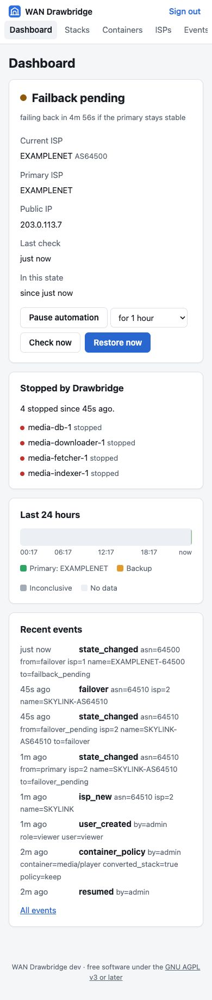 | 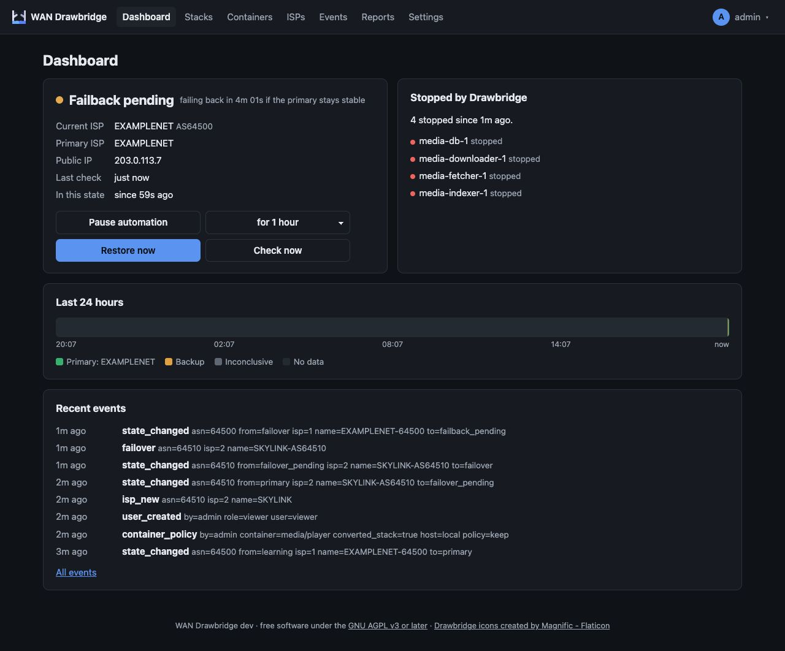 |
| 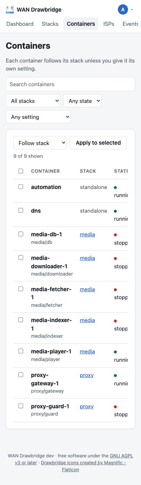 | 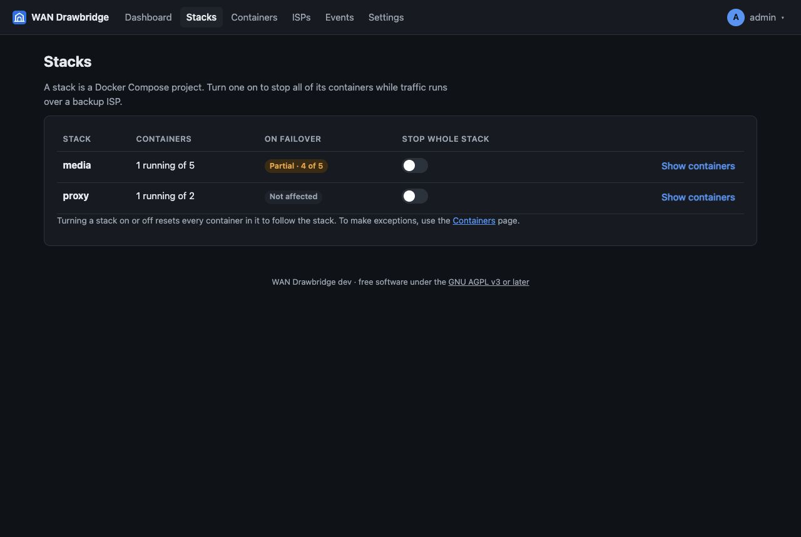 |

## Notes

- Over plain HTTP, browsers allow only about six open connections to one host.
  Each open Drawbridge tab keeps one for live updates, so with many tabs open
  pages can stall. Serving Drawbridge over HTTPS (through a reverse proxy)
  lifts this limit.
- Toast messages at the bottom confirm saves and show errors.
